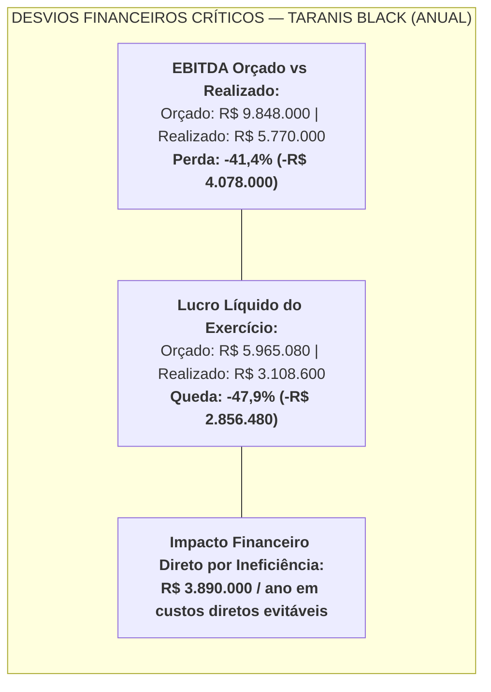
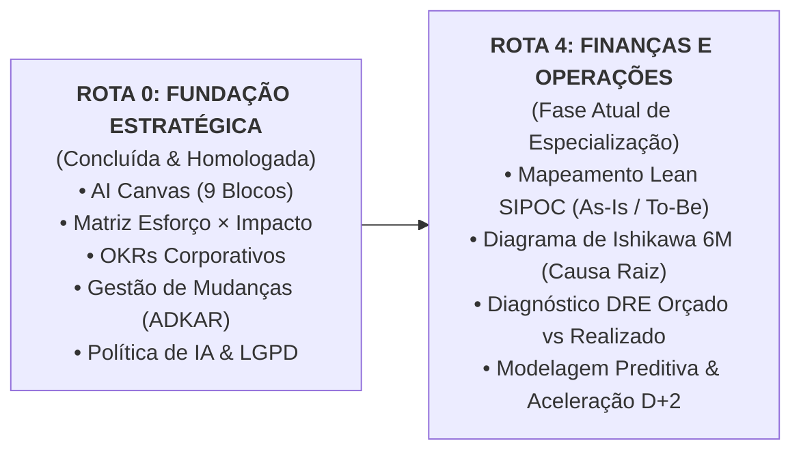

# 📋 CONTEXTO OFICIAL DO PROJETO & RADIOGRAFIA CORPORATIVA
**Projeto:** Challenge AI for Business — Taranis Black (ONE | G11)  
**Documento Mestre de Contexto Contínuo:** `00_contexto_e_regras/CONTEXTO_PROJETO.md`  
**Data de Atualização:** 2026-11-05 | Versão 1.0  
**Status do Projeto:** Rota 0 Concluída | Transição para a Rota 4 (Finanças e Operações)  

---

## 1. Dados Vitais e Perfil da Taranis Black

* **Natureza do Negócio:** Fabricante e distribuidora brasileira de mobiliário corporativo de alta performance e soluções de ergonomia ativa (cadeiras executivas, mesas com regulagem elétrica de altura e cabines acústicas modulares).
* **Faturamento Anual:** **R$ 48.000.000,00** (Ano Fiscal 2026).
* **Quadro de Colaboradores:** **280 profissionais** distribuídos entre sede administrativa, time comercial e operações fabris/logísticas.
* **Trajetória de Crescimento:** **35% ao ano** de expansão contínua nos últimos três exercícios fiscais.
* **Presença Geográfica & Infraestrutura:**
  * *Matriz Corporativa & Hub Comercial:* São Paulo / SP (onde residem as equipes executivas, comercial B2B, marketing e inteligência de mercado).
  * *Centro de Distribuição (CD) & Montagem Fabril:* Joinville / SC (ponto focal de estocagem, montagem técnica, roteirização de transporte e expedição de cargas).
* **Canais de Distribuição:**
  * *B2B Corporativo (Grandes e Médias Contas):* Representa **70% da receita total** (~R$ 33,6 milhões/ano), com vendas de alto tíquete médio faturadas a prazo (condição padrão 30-60-90 dias) e volume mensal de 180 a 220 pedidos corporativos.
  * *D2C / E-commerce:* Representa **30% da receita total** (~R$ 14,4 milhões/ano), com vendas diretas de acessórios e periféricos ergonômicos.
* **Portfólio de Produtos & Linhas Comerciais:**
  1. *Taranis ErgoPro (Cadeiras Corporativas de Alta Performance):* 48,5% da receita. Foco em conformidade com a NR-17, suporte lombar dinâmico e 5 anos de garantia.
  2. *Taranis SmartDesk (Mesas Elevatórias com Motor Duplo):* 27,5% da receita. Alternância postural ativa, memória digital de altura e estrutura reforçada.
  3. *Taranis Silence (Cabines Acústicas Modulares para Open Spaces):* 18,0% da receita. Isolamento acústico de 32 dB, ventilação ativa e montagem técnica in loco.
  4. *Acessórios & Periféricos Ergonômicos:* 6,0% da receita. Suportes articulados de monitor, apoios de pés e esteiras de organização de cabos.

---

## 2. Diagnóstico Quantitativo Consolidado (As-Is)

O crescimento de 35% ao ano sobrecarregou os sistemas legados e os processos humanos. As operações continuaram dependentes de controles manuais e planilhas desconectadas, desencadeando um desvio orçamentário crônico no último exercício:

### 2.1 Tabela de Gargalos Operacionais e Custos Diretos

| Gargalo Operacional Mapeado | Linha de Base (Situação Atual) | Meta / Benchmark | Desvio Observado | Impacto Financeiro Anual Direto |
|---|---|---|---|---|
| **Tempo de Fechamento Contábil Mensal** | **7 dias úteis** de esforço | 2 dias úteis (D+2) | +5 dias de atraso recorrente | **R$ 180.000 / ano** em horas extras e auditorias contábeis externas |
| **Tempo de Homologação de Crédito B2B** | **48 horas úteis** em fila | Máximo 4 horas | +44 horas de retenção | **R$ 1.250.000 / ano** em pedidos cancelados por morosidade |
| **Reentregas & Fretes Expressos de Emergência** | **2,8%** do faturamento bruto | 0,8% do faturamento | +2,0 p.p. de teto estourado | **R$ 960.000 / ano** em fretes duplicados (erros na NF-e/expedição) |
| **Inadimplência B2B Acima de 90 Dias (PDD)** | **3,4%** da receita líquida | 1,2% da receita | +2,2 p.p. de risco | **R$ 1.110.000 / ano** em perdas de crédito e provisões |
| **Divergência em Boletos & Faturamentos** | **6,8%** das NF-e emitidas | < 0,5% das NF-e | +6,3 p.p. de retrabalho | **R$ 390.000 / ano** em custos de cancelamento, juros e reemissão |
| **SOMA TOTAL DE PERDAS OPERACIONAIS** | — | — | — | **R$ 3.890.000 / ano** |

---

## 3. Escopo do Projeto & Conexões Metodológicas

* **Rota 0 (Fundação Estratégica - Concluída):**
  * Estabeleceu o *business case* de recuperação de mais de R$ 2,5 milhões de margem líquida com investimento inicial de R$ 250 mil (ROI de ~900% e Payback em 1,2 meses).
  * Criou a Matriz de Priorização 2x2, definindo o *Pré-Validador de NF-e* como Quick Win imediato (Onda 1), a *Conciliação Contábil* como Onda 2 e o *Motor de Crédito B2B* como Onda 3.
  * Estruturou os OKRs de 6 meses e o plano de gestão de mudanças ADKAR para os 280 colaboradores.
  * Instituiu a Política de IA Responsável em conformidade rigorosa com a LGPD.
* **Rota 4 (Finanças e Operações - Em Execução):**
  * Aplicação prática das metodologias Lean Seis Sigma para diagnosticar a esteira de pedidos corporativos:
    1. *Matriz SIPOC:* Mapeamento estruturado de Fornecedores, Entradas, Processo em 5 passos manuais, Saídas e Clientes.
    2. *Diagrama de Ishikawa (6M):* Correlação exaustiva das causas-raiz nos eixos Método, Máquina, Mão de Obra, Material, Medição e Meio Ambiente.
    3. *Diagnóstico DRE Orçado vs. Realizado:* Análise profunda de variância das contas contábeis e modelagem de estresse operacional.
* **Padrão de Comunicação Institucional:**
  * Tom estritamente sênior, analítico, quantitativo e pronto para apresentação C-Level à CEO da Taranis Black.
  * Todo e qualquer dado citado deve ser derivado e validado contra o repositório de dados brutos (`01_dados_originais/kit_de_dados/`).
