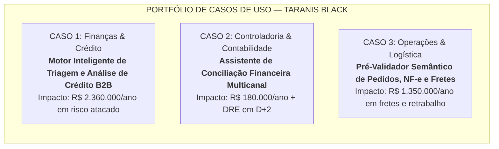

# 🏛️ AI CANVAS CORPORATIVO — TARANIS BLACK
**Documento Estratégico de Fundação da Rota 0 | AI for Business (ONE G11)**  
**Público-Alvo:** CEO, Diretoria Executiva (C-Level) e Conselho Consultivo  
**Data de Emissão:** Ano Fiscal 2026 | Versão 1.0  
**Autor:** Consultoria de IA  

---

## Executive Summary: O Momento de Inflexão da Taranis Black

A **Taranis Black** alcançou a marca de **R$ 48 milhões de faturamento anual**, impulsionada por um crescimento acelerado de **35% ao ano nos últimos três exercícios**. Entretanto, a infraestrutura operacional e contábil não acompanhou essa escala: a dependência de processos manuais, sistemas legados desconectados e triagens despadronizadas gerou um gargalo sistêmico que está comprimindo a rentabilidade da companhia.

No último exercício, enquanto a receita bruta se manteve próxima da meta orçada (-1,2%), o **EBITDA realizado despencou 41,4%** (de R$ 9,85M para R$ 5,77M) e o **Lucro Líquido encolheu 47,9%** (de R$ 5,96M para R$ 3,11M). As ineficiências operacionais mapeadas drenam **R$ 3,89 milhões por ano** em perdas diretas evitáveis (fretes de emergência, perdas de crédito, cancelamentos comerciais e horas extras).

O presente **AI Canvas Corporativo** estabelece a fundação estratégica para transformar a Inteligência Artificial no motor de recuperação de margem e sustentação do crescimento da Taranis Black, garantindo que o avanço comercial de 35% a.a. se traduza em lucratividade líquida real e governada.

---

## 1. O AI Canvas Corporativo (Matriz de 9 Blocos Estratégicos)

```mermaid
flowchart TD
    subgraph AI_CANVAS["AI CANVAS CORPORATIVO — TARANIS BLACK"]
        direction TB
        subgraph LINHA1["Camada de Entrega & Criação de Valor"]
            direction LR
            B1["1. Proposta de Valor com IA<br>• Recuperação de R$ 3,89M de margem<br>• Ciclo de faturamento de 5d para <24h<br>• Fechamento contábil em D+2"]
            B2["2. Problemas & Dores Centrais<br>• ERP legado sem APIs modernas<br>• 44h de fila em análise de crédito<br>• 6,8% de divergências em NF-e e boletos"]
            B3["3. Beneficiários Internos & Clientes<br>• Controladoria & Finanças<br>• Logística & Centro de Distribuição<br>• Diretoria Executiva & Clientes B2B"]
        end
        subgraph LINHA2["Camada de Solução & Capacidade Técnica"]
            direction LR
            B4["4. Soluções de IA Priorizadas<br>• Motor Inteligente de Crédito B2B<br>• Assistente de Conciliação Contábil<br>• Pré-Validador Semântico de Pedidos"]
            B5["5. Dados & Ativos Estratégicos<br>• Propostas comerciais em PDF<br>• Histórico de DRE e conciliações<br>• Tabela oficial de produtos e fretes"]
            B6["6. Infraestrutura & Modelos<br>• LLMs Corporativos (Claude 3.5 / GPT-4o)<br>• Orquestração híbrida com Python/Make<br>• Repositório com criptografia e RBAC"]
        end
        subgraph LINHA3["Camada Financeira & Governança"]
            direction LR
            B7["7. Custos & Recursos de IA<br>• Licenciamento e tokens LLM<br>• Integração com ERP e consultoria<br>• Capacitação do time de finanças"]
            B8["8. Retorno & ROI Esperado<br>• ROI de 6,2x no 1º ano<br>• Recuperação de R$ 2,5M+ de EBITDA<br>• Payback estimado em 3,5 meses"]
            B9["9. Riscos & Governança (LGPD)<br>• Pseudoanonimização de dados PII<br>• Guardrails contra alucinações fiscais<br>• Política de IA e Comitê de Ética"]
        end
        LINHA1 --> LINHA2 --> LINHA3
    end
```

---

### Bloco 1: Proposta de Valor com IA
* **Recuperação Imediata de Margem Operacional:** conter a perda de R$ 3,89 milhões anuais decorrentes de falhas manuais de digitação, fretes expressos não previstos e pedidos cancelados por lentidão.
* **Escalabilidade Não Linear:** Permitir que o faturamento da Taranis Black cresça aos mesmos 35% ao ano sem a necessidade de expansão linear do quadro de assistentes administrativos e fiscais.
* **Agilidade Competitiva e SLA B2B:** Redução drástica do ciclo de vida do pedido corporativo (Lead Time de faturamento caindo de 5 dias úteis para menos de 24 horas úteis).
* **Visibilidade Gerencial em Tempo Real:** Disponibilização de fechamentos contábeis em **D+2 úteis** (em vez de D+7), permitindo que a Diretoria Executiva tome decisões orçamentárias antes do encerramento da primeira semana do mês subsequente.

---

### Bloco 2: Problemas & Dores Centrais
* **Fragmentação Sistêmica e Dependência de Planilhas:** A operação depende da triangulação manual entre 3 planilhas locais do Excel (`Controle_Limites_2026.xlsx`, `Tabela_Precos_Vendas.xlsx` e conferência de fretes) e um ERP legado desconectado.
* **Gargalo de Aprovação Hierárquica:** Inexistência de motor de regras para crédito. Todos os pedidos (mesmo de R$ 8.000 para clientes de baixo risco) aguardam aprovação manual do Gerente Financeiro por e-mail, retendo o fluxo por até 48 horas úteis.
* **Elevado Retrabalho Logístico e Fiscal:** Cópia e colagem humana de dados do PDF da proposta para o ERP resulta em 6,8% de divergências fiscais e R$ 960.000/ano em reentregas e fretes emergenciais duplicados entre Joinville/SC e São Paulo.
* **Desmotivação e Risco de Burnout:** Assistentes financeiros sobrecarregados com digitação mecânica, gerando turnover e horas extras crônicas (R$ 180.000/ano).

---

### Bloco 3: Clientes & Beneficiários Internos
1. **Diretoria Executiva (CEO e CFO):** Relatórios de DRE e EBITDA confiáveis no 2º dia útil de cada mês; proteção do valuation da empresa e previsibilidade de caixa.
2. **Controladoria & Finanças:** Eliminação das rotinas manuais de conciliação entre extratos bancários, adquirentes e boletos; foco em análise financeira estratégica e auditoria de anomalias.
3. **Operações, Logística e Centro de Distribuição (Joinville/SC):** Recebimento de ordens de expedição protegidas contra erros de cadastro, acabamento, alíquotas ou divergências de frete CIF/FOB.
4. **Time Comercial B2B (Consultores & SDRs):** Resposta de liberação de pedidos em menos de 1 hora, reduzindo cancelamentos de clientes frustrados e acelerando comissões.
5. **Clientes Corporativos (Compradores B2B):** Cumprimento rigoroso do prazo de entrega de mobiliário, sem divergências nas especificações dos produtos ou nas notas fiscais emitidas.

---

### Bloco 4: Soluções Propostas (Aplicações de IA Corporativa)
* **Motor Inteligente de Crédito B2B (Solução Analítica + RAG):** Extração multimodal de dados cadastrais de propostas comerciais (PDF), consulta automatizada via API ao bureau de crédito (Serasa) e classificação de risco com recomendação instantânea de concessão de limite.
* **Assistente de Conciliação e Fechamento Contábil (Agentic Workflow):** Algoritmo de cruzamento probabilístico e correspondência semântica entre DRE, lançamentos do ERP e movimentações financeiras, identificando automaticamente divergências e elaborando a prévia contábil.
* **Pré-Validador Semântico de Pedidos e Fretes (OCR Inteligente + LLM Guardrails):** Validação cruzada pré-emissão entre a proposta assinada pelo cliente, a tabela de preços oficial do catálogo e as regras logísticas de frete CIF/FOB antes da transmissão da NF-e ao CD de Joinville.

---

### Bloco 5: Dados & Ativos Estratégicos
* **Documentos e Propostas Comerciais:** Arquivos PDF contendo propostas assinadas, contratos sociais de clientes, inscrições estaduais e especificações técnicas de lotes.
* **Histórico Financeiro e Transacional:** Registros dos últimos 36 meses de faturamento, conciliações bancárias, títulos pagos e histórico de devedores duvidosos (PDD) arquivados no ERP.
* **Bases de Produtos e Tabelas Oficiais:** Catálogo de produtos parametrizado com especificações ergonômicas, códigos SKU, regras fiscais por estado (ICMS-ST) e tabela de transportadoras homologadas.
* **Dados Externos de Birô:** APIs de bureaus de crédito (Serasa Experian / Sintegra / Receita Federal) para validação cadastral e de idoneidade jurídica.

---

### Bloco 6: Infraestrutura, Modelos & Tecnologia
* **Modelos de Linguagem Primários (LLMs):** Modelos corporativos de ponta com capacidade de raciocínio estruturado e janelas de contexto amplas (ex: Anthropic Claude 3.5 Sonnet / OpenAI GPT-4o) para parsing documental e síntese analítica.
* **Mecanismo de Orquestração:** Pipelines em Python (pandas, openpyxl, pydantic) combinados com plataformas de orquestração de fluxos (Make / n8n / APIs REST) para integração de sistemas legados sem necessidade de troca do ERP.
* **Ambiente de Processamento Governança:** Workspace em nuvem empresarial privada (ex: AWS ou Azure com isolamento tenant-level) garantindo que nenhum dado corporativo da Taranis Black seja utilizado no retreinamento público de modelos fundacionais.
* **Segurança e Acesso:** Autenticação baseada em funções (RBAC - Role-Based Access Control) e criptografia em trânsito (TLS 1.3) e em repouso (AES-256).

---

### Bloco 7: Custos & Recursos Necessários (CAPEX & OPEX de IA)
* **Investimento em Infraestrutura & APIs de IA (OPEX):** Assinatura de instâncias corporativas de LLMs e consumo de tokens para processamento de ~220 propostas mensais e fechamentos contábeis: **R$ 36.000 / ano**.
* **APIs de Bureaus de Crédito e Validação Fiscal (OPEX):** Pacotes de consultas automatizadas de crédito e CNPJ: **R$ 24.000 / ano**.
* **Consultoria de Implementação e Engenharia de Software (CAPEX Inicial):** Desenvolvimento dos scripts de integração, guardrails de validação e implantação dos agentes: **R$ 160.000 (pagamento único)**.
* **Capacitação e Gestão de Mudança (Change Management):** Treinamento da equipe de Finanças, Controladoria e Expedição: **R$ 30.000**.
* **Custo Total do 1º Ano:** **R$ 250.000**.

---

### Bloco 8: Fontes de Retorno & ROI Esperado
* **Impacto Anual das Soluções de IA:**
  - Redução de pedidos cancelados por lentidão de crédito: **+R$ 875.000 / ano recuperados** (recuperação de 70% das perdas atuais).
  - Redução de fretes expressos e reentregas por erro de digitação: **+R$ 672.000 / ano economizados** (eliminação de 70% dos desvios).
  - Recuperação de inadimplência e controle de crédito: **+R$ 555.000 / ano** (redução de 50% nas perdas de PDD).
  - Eliminação de divergências em boletos e cancelamentos de NF-e: **+R$ 273.000 / ano** (redução de 70%).
  - Economia de horas extras em fechamentos e auditorias contábeis: **+R$ 126.000 / ano**.
* **Benefício Financeiro Total Consolidado (Ano 1):** **R$ 2.501.000 / ano de recuperação direta de caixa e EBITDA**.
* **Retorno sobre o Investimento (ROI no 1º Ano):**
  $$\text{ROI} = \frac{\text{Benefício Líquido}}{\text{Investimento Total}} = \frac{R\$\ 2.501.000 - R\$\ 250.000}{R\$\ 250.000} = \frac{R\$\ 2.251.000}{R\$\ 250.000} \approx \mathbf{900\% \text{ (9,0x)}}$$
* **Período de Payback:** **Aproximadamente 1,2 meses**.

---

### Bloco 9: Riscos, Ética e Governança
* **Conformidade com a LGPD (Lei 13.709/2018):** Obrigação estrita de anonimização e mascaramento de dados identificáveis (PII) de colaboradores e compradores antes de qualquer envio de payloads para APIs de LLM.
* **Blindagem contra Alucinações Fiscais e Contábeis:** Nenhuma decisão contábil ou fiscal será executada de forma 100% autônoma (*Human-in-the-loop*); a IA atua como assistente recomendador de conferência, cabendo a aprovação final ao profissional responsável.
* **Trilha de Auditoria (Audit Trail):** Registro de logs estruturados contendo timestamp, modelo utilizado, prompt emitido, pontuação de confiança e justificativa lógica para todas as análises de crédito sugeridas.
* **Resistência Cultural e Adoção:** Plano de capacitação estruturado (Metodologia ADKAR) com foco na valorização do profissional humano, liberando os assistentes da digitação burocrática para funções de análise.

---

## 2. Detalhamento dos 3 Casos de Uso Prioritários

---

### CASO DE USO 1 (Finanças & Crédito): Motor Inteligente de Triagem e Análise de Crédito B2B

#### A. Problema Atacado e Impacto Financeiro Direto
* **Diagnóstico Atual:** Cada proposta comercial em PDF recebida exige 40 minutos de triagem manual do assistente (chaveando entre ERP, Serasa e a planilha `Controle_Limites_2026.xlsx`). Além disso, como inexiste motor de regras, qualquer pedido aguarda aprovação de alçada do Gerente Financeiro por e-mail, retendo pedidos por até **48 horas úteis**.
* **Impacto Financeiro Direto:**
  - **R$ 1.250.000 / ano** perdidos em pedidos de compras B2B cancelados por clientes frustrados com a morosidade da liberação comercial.
  - **R$ 1.110.000 / ano** em perdas por inadimplência (>90 dias / PDD) decorrentes de análises de crédito superficiais feitas sob pressão de tempo no final do mês.
  - **Total de Risco Operacional Atacado:** **R$ 2.360.000 / ano**.

#### B. Mecanismo da Solução de IA
* **Arquitetura da Solução:** Agente Especialista de Crédito com Processamento de Linguagem Natural (NLP) e Motor de Decisão Heurístico-Probabilístico:
  1. **Extração Multimodal (Document AI):** Ao receber o e-mail do vendedor com o PDF da proposta, o agente extrai instantaneamente CNPJ, Razão Social, Condição de Pagamento (ex: 30-60-90 dias), Valor Total e Linha de Produtos cotados.
  2. **Enriquecimento Automatizado de Dados:** O sistema dispara queries simultâneas para o bureau de crédito (Serasa Experian) e consulta o histórico transacional do cliente no banco de dados do ERP legado.
  3. **Motor de Scoring e Matriz de Alçada Automatizada:** Aplicação de regras paramétricas parametrizadas:
     - *Nível Verde (Fast-Track Automático):* Score Serasa > 750, sem pendências financeiras, histórico positivo na casa e pedido até R$ 80.000 $\rightarrow$ **Aprovação automática em < 2 minutos**, sem intervenção humana.
     - *Nível Amarelo (Aprovação Assistida):* Score entre 600 e 750 ou novos clientes até R$ 150.000 $\rightarrow$ Geração de dossiê executivo com recomendação estruturada enviada via webhook para aprovação em um clique no WhatsApp/Telegram do Gerente Financeiro.
     - *Nível Vermelho (Risco Elevado):* Score < 600 ou restrições ativas $\rightarrow$ Proposta recusada ou direcionada para exigência de pagamento antecipado (PIX/Sinal).

#### C. Insumos de Dados Consumidos
* Propostas comerciais assinadas em formato PDF anexadas nos e-mails comerciais.
* Base de clientes e histórico de compras anteriores no ERP legado.
* Respostas das APIs do Serasa Experian (Score, protestos, ações judiciais, dívidas ativas).
* Planilha parametrizada de limites de crédito e regras de governança financeira.

#### D. Indicadores de Sucesso (KPIs Mensuráveis)
* **SLA de Análise e Liberação de Crédito:** Redução de **48 horas úteis para menos de 15 minutos** nos pedidos de Fast-Track (< 1 hora na média geral).
* **Taxa de Concessão Automatizada:** Pelo menos **65% dos pedidos B2B** processados sem toque manual da liderança.
* **Índice de Inadimplência (>90 dias):** Redução do patamar atual de **3,4% para menos de 1,5%** da receita líquida anual.
* **Recuperação de Vendas Represadas:** Redução de **75% nos cancelamentos** de pedidos em carteira por lentidão de análise.

---

### CASO DE USO 2 (Controladoria & Fechamento): Assistente de Conciliação Financeira Multicanal e Fechamento Contábil

#### A. Problema Atacado e Impacto Financeiro Direto
* **Diagnóstico Atual:** O fechamento mensal da Taranis Black demanda **7 dias úteis** (desvio de +5 dias além da meta de 2 dias). A equipe de contabilidade despende centenas de horas em conferências manuais de lançamentos entre extratos de 3 bancos, relatórios de meios de pagamento de vendas diretas pelo site, boletos B2B emitidos e as contas contábeis do ERP.
* **Impacto Financeiro Direto:**
  - **R$ 180.000 / ano** em despesas diretas com horas extras da equipe de controladoria, consultorias contábeis de ajuste e custos extras de auditoria externa.
  - **Custo de Oportunidade Incalculável:** Cegueira gerencial durante os primeiros 7 dias do mês, impedindo o CFO e a Diretoria de identificarem desvios orçamentários a tempo de intervir na produção e compras.

#### B. Mecanismo da Solução de IA
* **Arquitetura da Solução:** Assistente Baseado em Agente Analítico (Python + Claude 3.5 Sonnet / GPT-4o Code Interpreter) com *Fuzzy Matching* Semântico e Auditoria de Balancetes:
  1. **Ingestão Diária Automatizada:** Extração de extratos bancários (OFX/CSV), relatórios de faturamento do ERP e relatórios de adquirentes e-commerce via agendamento noturno.
  2. **Conciliação e Reconciliação Probabilística:** O algoritmo cruza valores, datas e códigos de transação. Para inconsistências causadas por tarifas bancárias não provisionadas ou juros parciais, o modelo semântico realiza o pareamento por similaridade (*fuzzy logic*), atribuindo scores de correspondência.
  3. **Identificação e Pré-Classificação de Divergências:** Transações não conciliadas são agrupadas por padrões (ex.: cliente pagou boleto com desconto indevido de R$ 50) e recebem sugestão automática de estorno ou lançamento contábil.
  4. **Geração Automatizada da Minuta do DRE Executivo:** O assistente gera diariamente o DRE preliminar e aponta os desvios entre Orçado vs. Realizado, gerando resumos analíticos narrativos prontos para consumo da diretoria.

#### C. Insumos de Dados Consumidos
* Extratos bancários diários em formato OFX e CSV de todas as contas correntes corporativas.
* Relatórios analíticos de faturamento, vendas e cancelamentos extraídos do ERP.
* Base histórica de plano de contas contábeis da Taranis Black.
* Planilha orçamentária anual com as metas trimestrais de despesas (OPEX) e receitas.

#### D. Indicadores de Sucesso (KPIs Mensuráveis)
* **Tempo de Fechamento Contábil Mensal:** Redução de **7 dias úteis para 2 dias úteis (D+2)**.
* **Acurácia na Conciliação de Contas:** Índice de conciliação automática superior a **94% dos lançamentos bancários**.
* **Redução de Horas Extras de Controladoria:** Queda de **80% nos dispêndios de sobrejornada** nos períodos de fechamento mensal.
* **Disponibilidade do Dashboard de DRE:** Atualização diária (D+1) da margem bruta e EBITDA para o C-Level.

---

### CASO DE USO 3 (Operações & Logística): Pré-Validador Semântico de Pedidos, NF-e e Roteirização de Fretes

#### A. Problema Atacado e Impacto Financeiro Direto
* **Diagnóstico Atual:** Ao transpor manualmente as informações da proposta em PDF para o espelho da Nota Fiscal no ERP, os assistentes cometem erros rotineiros de digitação de SKU (ex: registrar cadeira com acabamento mesh cinza quando o cliente comprou preto), erros de Inscrição Estadual e omissão da regra de frete (CIF vs FOB). O caminhão da transportadora chega ao CD de Joinville/SC e é retido por divergência fiscal, acarretando diárias de pátio e fretes duplicados.
* **Impacto Financeiro Direto:**
  - **R$ 960.000 / ano** em despesas adicionais com reentregas, armazenagem extraordinária e contratação de fretes expressos de emergência para cobrir atrasos.
  - **R$ 390.000 / ano** em custos operacionais com cancelamento e reemissão de notas fiscais, perda de crédito de ICMS e protestos indevidos de clientes causados por boletos com valores divergentes da proposta original (atingindo 6,8% das NF-e).
  - **Total de Perdas Atacado:** **R$ 1.350.000 / ano**.

#### B. Mecanismo da Solução de IA
* **Arquitetura da Solução:** Pipeline de Auditoria Semântica Prévia (Zero-Shot Validation + Guardrails Estruturados):
  1. **Conferência Cruzada Bidirecional (Cross-Validation):** Antes que a ordem de faturamento seja gravada definitivamente no ERP, um pipeline automatizado compara os dados estruturados do pedido com o PDF original da proposta assinada.
  2. **Validação Heurística de Regras de Negócio e Engenharia:**
     - *Verificação de SKU e Configurações:* Confirmação se as cores, materiais, braços ajustáveis e especificações de NR-17 correspondem à matriz oficial do catálogo `01_Catalogo_Produtos_e_Precos_Taranis_Black.docx`.
     - *Checagem Automática de Frete (CIF vs FOB):* Se a proposta indicar entrega CIF (por conta da Taranis Black), o sistema audita se a margem líquida do pedido cobre a cotação da transportadora cadastrada no CD de Joinville.
     - *Auditoria Fiscal e Tributária:* Validação de alíquotas de ICMS/DIFAL e suficiência de dados de entrega antes do envio para a SEFAZ.
  3. **Disparo de Alertas e Liberação Automática do Picking:** Havendo divergência de qualquer centavo ou código de produto, o pedido é travado em quarentena com destaque visual do erro para o vendedor corrigir em menos de 5 minutos. Estando 100% íntegro, a ordem de separação (*Picking List*) é transmitida via webhook para o CD de Joinville/SC em tempo real.

#### C. Insumos de Dados Consumidos
* Catálogo de produtos parametrizado com códigos SKU oficiais, atributos e regras de precificação.
* Arquivos PDF das propostas comerciais assinadas pelos clientes corporativos.
* Tabela de fretes homologados por região, rotas do CD Joinville/SC e regras de cubicagem/peso.
* Banco de regras tributárias e cadastros de clientes da SEFAZ.

#### D. Indicadores de Sucesso (KPIs Mensuráveis)
* **Taxa de Divergência em NF-e Emitidas:** Redução de **6,8% para menos de 0,3%** de inconsistências faturadas.
* **Custo de Fretes de Emergência / Faturamento:** Queda do custo de fretes extras de **2,8% para 0,6% da receita bruta** (economia de mais de R$ 700k/ano).
* **Tempo de Transmissão Comercial $\rightarrow$ Expedição CD:** Redução de **3 dias úteis para menos de 2 horas** após a aprovação do crédito.
* **Índice de Reentregas e Devoluções por Incompatibilidade:** Redução de **90% nas recusas de mercadoria** na doca do cliente.

---

## 3. Matriz Sintética de Comparação dos Casos de Uso

| Dimensão Estratégica | Caso 1: Motor de Crédito B2B | Caso 2: Conciliação & Fechamento | Caso 3: Pré-Validador NF-e & Fretes |
|---|---|---|---|
| **Área Beneficiária** | Crédito & Vendas Corporativas | Controladoria & Contabilidade | Operações, Faturamento & CD |
| **Gargalo Atual** | 48h de espera por e-mail manual | 7 dias úteis no fechamento mensal | 6,8% de notas fiscais com erro |
| **Tecnologia Central** | Document AI + Scoring + Webhooks | Python + Fuzzy Matching + GenAI | Cross-Validation + Guardrails Semânticos |
| **Perda Atual Anual** | R$ 2.360.000 / ano | R$ 180.000 / ano + cegueira de caixa | R$ 1.350.000 / ano |
| **Recuperação Estimada** | **R$ 1.430.000 / ano** | **R$ 126.000 / ano** | **R$ 945.000 / ano** |
| **Tempo de Implementação** | 6 a 8 semanas | 4 a 6 semanas | 4 a 5 semanas |
| **Grau de Complexidade** | Média-Alta (Integração Serasa/ERP) | Média (Tratamento de bases internas) | Média-Baixa (Validação de regras) |
| **Nível de Risco Governança** | Alto (Decisão financeira de concessão) | Baixo-Médio (Auditoria interna) | Baixo (Conferência de dados cadastrais) |

---

## 4. Recomendações de Governança para o Conselho Executivo

1. **Aprovação Imediata da Fase Piloto:** Priorizar a implementação técnica do **Caso 3 (Pré-Validador de NF-e)** como *Quick Win* (resultado visível em 30 dias), seguido em paralelo pelo **Caso 1 (Motor de Crédito)** para conter o cancelamento de grandes contas corporativas.
2. **Instituição do Comitê de Governança de IA (AI Steering Committee):** Composto pela CEO, Gerente Financeiro, Coordenador de Operações e o Consultor Técnico de IA, com reuniões quinzenais para acompanhamento dos KPIs de retorno.
3. **Conformidade Ética e Human-in-the-Loop:** Garantir que 100% das decisões de crédito de alto valor (> R$ 100.000) ou classificações contábeis anômalas passem pela validação explícita de um gestor humano qualificado, utilizando a IA como co-piloto de produtividade e precisão.

---
*Artefato estratégico homologado e pronto para submissão executiva e composição do relatório final da Rota 0.*
