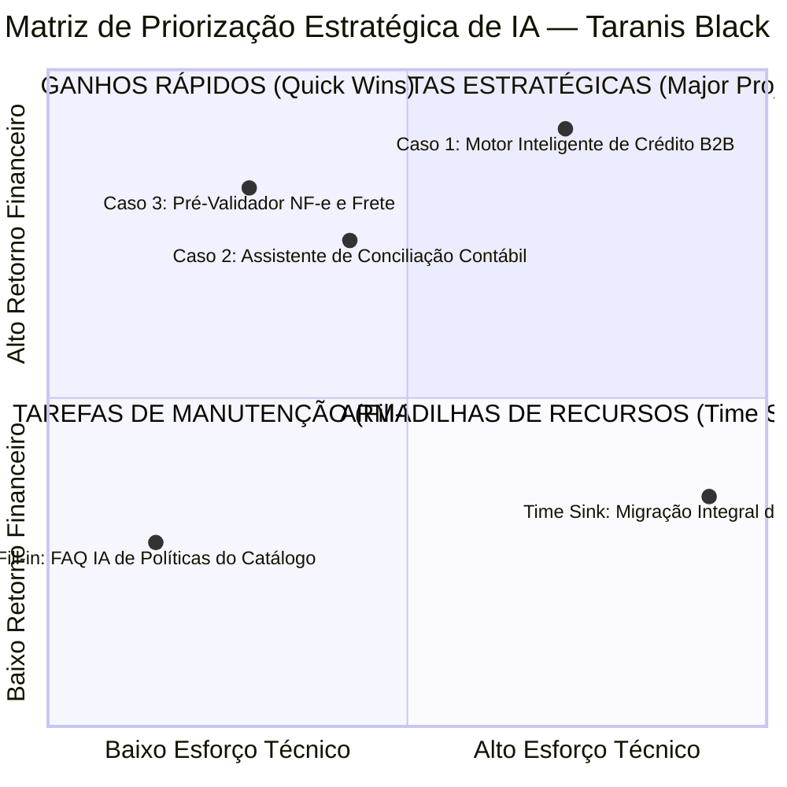
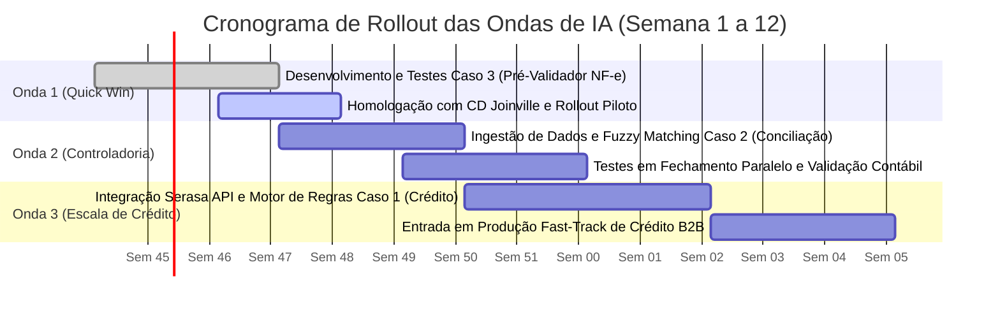
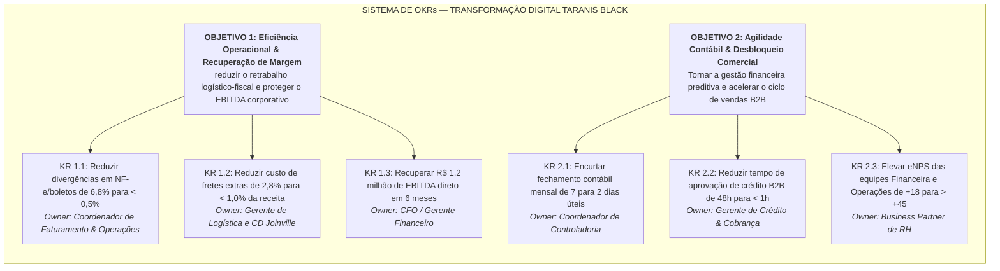
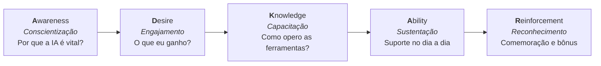

# 🎯 MATRIZ ESFORÇO × IMPACTO, PLANO DE MÉTRICAS (OKRs) & GESTÃO DE MUDANÇAS (ADKAR)
**Documento Estratégico da Rota 0 — Fundação de IA Corporativa | Taranis Black**  
**Público-Alvo:** CEO, Diretoria Financeira (CFO), Gerência de Operações e Lideranças de RH  
**Data de Emissão:** Ano Fiscal 2026 | Versão 1.0  
**Autor:** Consultor de IA  

---

## Executive Summary: Da Estratégia à Execução Operacional

A definição dos casos de uso no AI Canvas estabeleceu o potencial de recuperação de mais de **R$ 2,5 milhões de margem operacional** na Taranis Black. Contudo, em empresas de médio porte com crescimento acelerado (35% a.a.) e 280 colaboradores, o principal fator de falha em iniciativas de inteligência artificial não reside na tecnologia, mas sim na **falta de priorização executiva orientada a valor rápido** e na **resistência cultural de equipes acostumadas a rotinas manuais**.

Este documento estabelece o plano tático-operacional de implementação da Rota 0 em três pilares integrados:
1. **Matriz de Priorização 2×2 (Esforço × Impacto):** Classificação técnica e temporal das iniciativas, determinando a sequência de ondas de implantação (*rollout*).
2. **Plano de Métricas e OKRs Corporativos:** Estabelecimento de metas numéricas rígidas atreladas ao DRE da empresa, confrontando as linhas de base auditadas com as metas para os próximos 6 meses.
3. **Plano de Gestão de Mudanças Organizacionais (Modelo ADKAR):** Framework sistemático para engajar as equipes de Operações, Finanças e Vendas, mitigando o receio de substituição e consolidando a cultura de "Human-in-the-Loop".

---

## 1. Matriz Esforço × Impacto (Priorização Estratégica)

### 1.1 Análise Detalhada dos Quadrantes

#### Quadrante 1: Ganhos Rápidos (*Quick Wins*) — Alto Impacto, Baixo a Médio Esforço
* **Iniciativa Alocada:** **Caso de Uso 3 — Pré-Validador Semântico de Pedidos, NF-e e Roteirização de Frete**
  * **Justificativa do Posicionamento:**
    - *Esforço Reduzido (Score 2.8/10):* Não depende de modificação no código-fonte do ERP legado. Atua como um *middleware* leve em Python/Make que intercepta os dados da proposta antes do envio à SEFAZ e compara com tabelas de referência já existentes (`01_Catalogo_Produtos_e_Precos_Taranis_Black.docx` e matriz de fretes do CD Joinville).
    - *Impacto Financeiro Imediato (Score 8.2/10):* Ataca de imediato **R$ 1.350.000 / ano** em perdas diretas (R$ 960k em fretes de emergência e R$ 390k em cancelamentos fiscais). Reduz o retrabalho visível na ponta em menos de 30 dias.
  * **Estimativa de Entrega:** 2 a 3 Sprints (4 semanas).

* **Iniciativa Alocada:** **Caso de Uso 2 — Assistente de Conciliação Financeira Multicanal e Fechamento Contábil**
  * **Justificativa do Posicionamento:**
    - *Esforço Moderado (Score 4.2/10):* Ingestão padronizada de arquivos OFX/CSV e planilhas contábeis estruturadas. Algoritmos de *fuzzy matching* e cruzamento de saldos possuem bibliotecas maduras e prontas para uso analítico.
    - *Impacto Estratégico & Financeiro (Score 7.4/10):* Destrava a "cegueira gerencial" do C-Level ao reduzir o fechamento de 7 para 2 dias úteis, eliminando **R$ 180.000 / ano** em horas extras e auditorias contábeis.
  * **Estimativa de Entrega:** 3 Sprints (6 semanas).

#### Quadrante 2: Apostas Estratégicas (*Major Projects*) — Altíssimo Impacto, Alto Esforço
* **Iniciativa Alocada:** **Caso de Uso 1 — Motor Inteligente de Triagem e Análise de Crédito B2B**
  * **Justificativa do Posicionamento:**
    - *Esforço Técnico-Operacional (Score 7.2/10):* Exige integração via API com sistemas de bureaus externos (Serasa Experian), modelagem de motor de decisão de crédito com matriz de alçadas e calibração de modelos para evitar tanto falso-positivos (concessão temerária) quanto falso-negativos (bloqueio indevido de vendas sadias).
    - *Altíssimo Impacto Financeiro (Score 9.1/10):* Ataca a maior dor de receita da empresa (**R$ 2.360.000 / ano** em risco, somando R$ 1,25M em vendas canceladas por lentidão e R$ 1,11M em inadimplência >90 dias).
  * **Estimativa de Entrega:** 4 a 5 Sprints (8 a 10 semanas).

#### Quadrante 3: Tarefas de Manutenção (*Fill-ins*) — Baixo Impacto, Baixo Esforço
* **Iniciativa:** Assistente de Consulta Rápida ao Catálogo e Regras de Frete para Consultores Comerciais (Bot no Slack/Teams).
  * *Papel no Roadmap:* Serve como subproduto de baixo custo desenvolvido durante o treinamento dos modelos do Caso 3.

#### Quadrante 4: Armadilhas de Recursos (*Time Sinks*) — Baixo/Médio Impacto, Esforço Extremo
* **Iniciativa Evitada:** Tentativa de substituição ou reescrita completa do ERP Legado da Taranis Black.
  * *Decisão Estratégica:* **Veto total.** Uma troca de ERP consumiria de 12 a 18 meses, milhões de reais e paralisaria a operação da empresa, gerando alto risco executivo. A abordagem com IA adota uma **camada não invasiva de inteligência e automação periférica (*wrapper architecture*)**, extraindo valor imediato dos sistemas existentes.

---

### 1.2 Sequência de Rollout em Ondas (Roteiro de Implementação)

* **Onda 1 — conter a perda Logístico-Fiscal (Semanas 1 a 4):**
  * *Foco:* Colocar o **Caso 3 (Pré-Validador Semântico de Pedidos e Fretes)** em produção assistida.
  * *Entregável:* Auditoria automática de 100% dos pedidos corporativos antes da transmissão ao CD de Joinville.
* **Onda 2 — Visibilidade Financeira & Fechamento em D+2 (Semanas 5 a 8):**
  * *Foco:* Implementação do **Caso 2 (Conciliação Multicanal e DRE Automatizado)**.
  * *Entregável:* Execução do primeiro fechamento mensal reduzido de 7 para 3 dias úteis na primeira rodada e 2 dias na subsequente.
* **Onda 3 — Liberação Comercial & Proteção de Crédito (Semanas 9 a 12):**
  * *Foco:* Entrada em produção do **Caso 1 (Motor Inteligente de Crédito B2B)**.
  * *Entregável:* Liberação automática de 65% dos pedidos em menos de 15 minutos e redução de 75% dos cancelamentos por espera.

---

## 2. Plano de Métricas & OKRs Corporativos

Para assegurar alinhamento executivo entre a estratégia de IA e os resultados do DRE, foram instituídos 2 Objetivos Estratégicos com metas numéricas a serem atingidas em um horizonte de **6 meses (2 trimestres fiscais)**.

### 2.1 Detalhamento Técnico dos Objetivos e Metas

#### OBJETIVO 1: Recuperação de Margem Líquida e Blindagem da Esteira Operacional
*Propósito:* Eliminar os custos invisíveis de ineficiência operacional que consumiram mais de 40% do EBITDA planejado no último exercício.

| Resultado-Chave (KR) | Situação Atual (Linha de Base Auditada) | Meta Almejada (6 Meses) | Impacto Financeiro Direto no DRE | Responsável de Negócio (*Owner*) |
|---|---|---|---|---|
| **KR 1.1:** Reduzir o percentual de divergências em faturamentos e notas fiscais emitidas. | **6,8%** do volume faturado gerando retrabalho | **< 0,5%** das NF-e | Economia de **R$ 350.000 / ano** em cancelamentos e juros | Coordenador de Faturamento |
| **KR 1.2:** Reduzir o custo relativo de fretes emergenciais e reentregas sobre o faturamento. | **2,8%** da receita bruta (R$ 1,36M de estouro) | **< 1,0%** da receita bruta | Economia de **R$ 800.000 / ano** em fretes duplicados | Gerente de Logística (CD Joinville) |
| **KR 1.3:** Recuperação de margem de contribuição líquida acumulada. | EBITDA de R$ 5,77M (-41,4% vs. orçado) | Recuperar **+R$ 1,2M** de margem nos próximos 2 trimestres | Retorno do EBITDA ao patamar de crescimento sustentado | CFO / Gerente Financeiro |

---

#### OBJETIVO 2: Agilidade Decisória, Desbloqueio Comercial e Bem-Estar das Equipes
*Propósito:* Transformar as áreas financeiras e operacionais de gargalos burocráticos em aceleradores estratégicos de receita.

| Resultado-Chave (KR) | Situação Atual (Linha de Base Auditada) | Meta Almejada (6 Meses) | Impacto Operacional / Governança | Responsável de Negócio (*Owner*) |
|---|---|---|---|---|
| **KR 2.1:** Reduzir a latência do Fechamento Contábil Mensal. | **7 dias úteis** (+5 dias de atraso recorrente) | **2 dias úteis (D+2)** | DRE disponível para a diretoria na primeira semana do mês | Coordenador de Controladoria |
| **KR 2.2:** Reduzir o tempo médio de ciclo de análise de crédito de propostas B2B. | **48 horas úteis** em espera de aprovação | **< 1 hora** (com 65% em Fast-Track < 15 min) | Recuperação de **R$ 900.000 / ano** em vendas retidas | Gerente de Crédito e Cobrança |
| **KR 2.3:** Reduzir o estresse operacional e elevar a satisfação interna das áreas impactadas. | eNPS setorial de **+18** e 24% de turnover prematuro | **eNPS > +45** e turnover < 10% | Redução drástica de burnout e absenteísmo por sobrecarga | BP de Recursos Humanos |

---

## 3. Plano de Gestão de Mudanças Organizacionais (Framework ADKAR)

Com um quadro de **280 colaboradores**, a Taranis Black vivencia um choque cultural: equipes de operações habituadas a "apagar incêndios" por e-mail e assistentes financeiros habituados à digitação manual sentem receio natural de serem substituídos pela inteligência artificial.

O plano de gestão de mudanças utiliza a metodologia **ADKAR (Awareness, Desire, Knowledge, Ability, Reinforcement)** para transformar a IA em um aliado de produtividade humana.

---

### 3.1 Os Cinco Pilares do ADKAR Aplicados à Taranis Black

#### 1. Awareness (Conscientização — "Por que mudar agora?")
* **Mensagem Executiva Central:** A Taranis Black está crescendo 35% ao ano. Se não automatizarmos as tarefas mecânicas, o volume de erros nos afogará e limitará o crescimento da companhia. A IA não está sendo implantada para reduzir postos de trabalho, mas para eliminar a digitação manual de dados que drena a energia da equipe.
* **Ações Estratégicas:**
  - *All-Hands Meeting com a CEO:* Apresentação aberta dos números da empresa, demonstrando com transparência como os R$ 3,89M em desperdício afetam os recursos para bônus e melhorias estruturais.
  - *Workshops de Desmistificação:* Sessões ao vivo demonstrando a diferença prática entre "automação de tarefas repetitivas" e "julgamento crítico humano", reafirmando que o humano sempre estará no comando (*Human-in-the-Loop*).
* **Canais:** Reunião geral presencial/híbrida, comunicados internos do RH e vídeos curtos no canal corporativo.

#### 2. Desire (Engajamento e Desejo — "O que eu ganho com isso?")
* **Mensagem Operacional Central:** "Chega de passar o final de mês até as 22h digitando notas e preenchendo planilhas no Excel. A IA fará a cópia mecânica de dados; você assumirá o papel de analista de estratégia e tomada de decisão."
* **Ações Estratégicas:**
  - *Pacto de Segurança e Valorização:* Compromisso formal da Diretoria Executiva de que o sucesso das automações se traduzirá em requalificação profissional (*reskilling*), não em demissões em massa.
  - *Mapeamento de Dores Individuais:* Rodas de conversa com os assistentes financeiros para identificar quais tarefas rotineiras mais geram exaustão mental, colocando-as no topo da esteira de automação.
* **Canais:** Conversas 1-on-1 de lideranças imediatas com seus liderados e fóruns de escuta ativa organizados pelo RH.

#### 3. Knowledge (Capacitação e Conhecimento — "Como utilizo na prática?")
* **Mensagem Educacional Central:** "Você não precisa aprender programação; você aprenderá a dialogar com os modelos e guiar as automações no seu dia a dia."
* **Ações Estratégicas:**
  - *Trilha 'IA para Finanças & Operações' (Alura Corporate / ONE G11):* Treinamento imersivo cobrindo:
    1. Engenharia de prompts para conferência contábil e interpretação de relatórios.
    2. Como auditar as recomendações do motor de crédito B2B e evitar alucinações.
    3. Como interagir com o pré-validador fiscal via interfaces simples e alertas de erro.
  - *Playbooks e Guias Práticos de Bolso:* Manuais rápidos com casos reais da Taranis Black (modelos de prompt para consulta de alíquotas de ICMS e políticas de frete).
* **Canais:** Plataforma de e-learning corporativa, workshops práticos semanais com turmas de até 15 colaboradores.

#### 4. Ability (Habilidade e Sustentação — "Como aplicar sem medo de errar?")
* **Mensagem de Suporte Central:** "No início, o sistema operará em modo assistido (*Shadow Testing*). Você valida o que a IA propõe; ninguém será penalizado por identificar falhas do algoritmo."
* **Ações Estratégicas:**
  - *Rede de Campeões de IA (AI Champions):* Seleção e treinamento de 5 assistentes e analistas referências em Finanças, Controladoria e no CD de Joinville para atuarem como monitores locais de dúvidas.
  - *Ambiente de Simulação Seguro (Sandbox):* Disponibilização de ambiente de testes onde os analistas podem rodar propostas simuladas sem risco de impactar a base de dados oficial do ERP.
  - *Plantão Semanal de Dúvidas ('Office Hours com a Consultoria'):* Sessões abertas de 1 hora semanal para sanar dificuldades de operação e aprimorar os prompts.
* **Canais:** Canal exclusivo no Teams/Slack (`#duvidas-ia-operacoes`) e atendimento presencial com os campeões setoriais.

#### 5. Reinforcement (Reforço e Sustentação Contínua — "Como consolidamos o hábito?")
* **Mensagem de Celebração Central:** "As conquistas da IA são conquistas da equipe. Cada fechamento acelerado é tempo recuperado para o nosso desenvolvimento."
* **Ações Estratégicas:**
  - *Premiação 'Inovadores Taranis Black':* Reconhecimento público trimestral aos colaboradores que propuserem melhorias nos prompts e fluxos de automação.
  - *Painel Visual de Eficiência (Dashboard de Conquistas):* Exibição em tempo real das horas manuais economizadas e das notas fiscais retidas com sucesso pelo pré-validador antes de gerarem multas.
  - *Atrelação a Metas de PLR:* Inclusão do atingimento do fechamento contábil em D+2 nas metas de remuneração variável das equipes de controladoria.
* **Canais:** Comunicação nos murais digitais da empresa, cerimônia de premiação trimestral e reuniões de alinhamento com a diretoria.

---

### 3.2 Matriz de Comunicação e Cronograma de Engajamento

| Semana | Fase ADKAR | Público-Alvo | Ação / Canal | Responsável Principal |
|---|---|---|---|---|
| **Semana 1** | Awareness | Todos os 280 colaboradores | *Town Hall*: "O Futuro da Taranis Black com Inteligência Artificial" | CEO e Consultor de IA |
| **Semana 2** | Desire | Finanças, Controladoria e CD | Reuniões setoriais: Apresentação do mapa de dores e alívio de sobrecarga | Gerentes de Área & RH |
| **Semanas 3-5** | Knowledge | Equipes de faturamento e crédito | Início da Trilha Prática de Prompts e Treinamento nos Validadores | Consultoria & L&D (RH) |
| **Semanas 6-8** | Ability | Operações e Controladoria | Implantação da *Rede de Campeões* e operação paralela assistida | Campeões de IA |
| **Semanas 9-12** | Reinforcement | Liderança e Colaboradores | Comemoração do primeiro fechamento em D+2 e premiação de destaques | CFO e Diretoria Executiva |

---

## 4. Matriz de Riscos de Implementação e Planos de Mitigação

| Risco Mapeado | Gravidade | Probabilidade | Estratégia de Mitigação |
|---|---|---|---|
| **Resistência Ativa de Analistas:** Recusa em usar as ferramentas por medo de automação. | Alta | Média | Envolvimento precoce na construção das regras; foco do treinamento na libertação de tarefas repetitivas. |
| **Alucinação ou Falso-Positivo no Crédito:** Recomendações de limite errôneas em clientes de risco. | Alta | Baixa | Implantação de limites rígidos (*hard caps*): qualquer crédito acima de R$ 80k exige confirmação humana. |
| **Descompasso entre TI e Operações:** Atraso na liberação de acessos e conectores de rede. | Média | Alta | Patrocínio executivo direto do CFO e reuniões diárias de 15 minutos (*Daily Scrum*) com o time técnico. |
| **Queda de Engajamento Pós-Lançamento:** Retorno aos velhos hábitos de comunicação por e-mail manual. | Média | Média | Travamento paulatino da caixa de entrada do financeiro; pedidos passam a ser submetidos apenas via formulário padrão. |

---
*Artefato estratégico homologado e pronto para submissão executiva e integração com o dossiê da Rota 0.*
