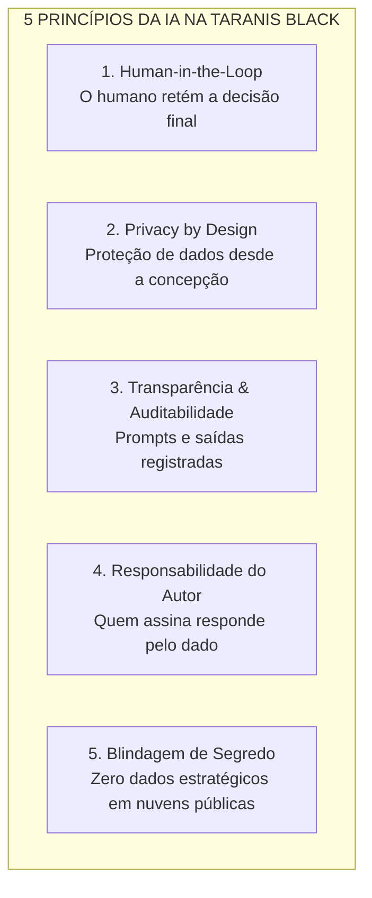
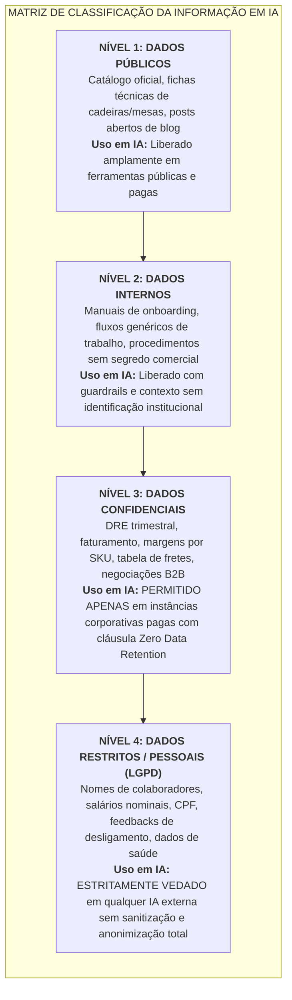
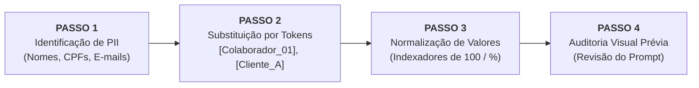
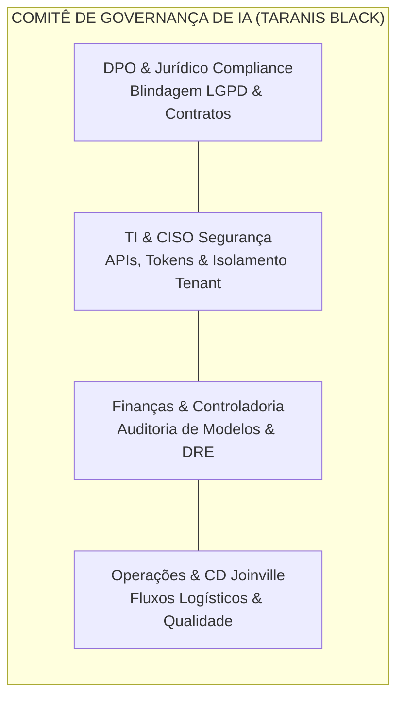

# 🛡️ POLÍTICA CORPORATIVA DE IA RESPONSÁVEL & DIRETRIZES DE CONFORMIDADE LGPD
**Taranis Black Mobiliário Corporativo & Ergonomia Ativa S.A.**  
**Código Normativo:** POL-GOV-IA-2026.1 | Versão 1.0  
**Aprovação:** Diretoria Executiva, Encarregado de Dados (DPO) e Comitê de Governança de IA  
**Data de Vigência:** Ano Fiscal 2026  
**Classificação do Documento:** Uso Interno Obrigatório (Todos os 280 Colaboradores)  

---

## 1. Objetivo, Escopo e Princípios Fundamentais

### 1.1 Objetivo
A presente Política estabelece os padrões institucionais, operacionais e jurídicos para a utilização ética, produtiva e segura de ferramentas de **Inteligência Artificial Generativa (GenAI), Modelos de Linguagem de Grande Porte (LLMs) e Sistemas Autônomos de Apoio à Decisão** no ecossistema da **Taranis Black**.

O propósito central é fomentar a inovação operacional e a recuperação de eficiência dos processos corporativos sem comprometer a confidencialidade das estratégias de negócio, a segurança dos ativos digitais e a privacidade de dados pessoais regulados pela **Lei Geral de Proteção de Dados (Lei nº 13.709/2018 - LGPD)**.

### 1.2 Escopo e Aplicabilidade
Esta norma possui aplicação necessária sobre:
* **Público:** Todos os **280 colaboradores diretos** da Taranis Black (CLT, diretores, gerentes, coordenadores, assistentes, estagiários e aprendizes).
* **Terceiros:** Consultores externos, prestadores de serviços de TI, agências de marketing, representantes comerciais autônomos e parceiros operacionais (incluindo o CD de Joinville/SC).
* **Verticais de Negócio:** Aplica-se integralmente a todas as operações:
  - **Rota 0 (Fundação Estratégica & Governança Corporativa);**
  - **Rota 1 (Vendas e Comercial B2B);**
  - **Rota 2 (Marketing e Criação de Conteúdo);**
  - **Rota 3 (Recursos Humanos e People Analytics);**
  - **Rota 4 (Finanças, Controladoria e Operações Logísticas).**
* **Tecnologias Cobertas:** Qualquer ferramenta baseada em IA de consumo ou corporativa, incluindo, mas não se limitando a: OpenAI ChatGPT, Anthropic Claude, Google Gemini, Microsoft Copilot, Make/Zapier com nós de IA, plugins de IA no Excel, scripts Python analíticos e modelos *open-source* locais.

### 1.3 Princípios Norteadores

---

## 2. Classificação da Informação e Diretrizes de Uso em IA

Para prevenir vazamento de segredos de negócio e violações regulatórias, toda informação manuseada na Taranis Black é categorizada em 4 níveis de sensibilidade, com regras estritas de submissão a sistemas de IA.

### 2.1 Diretrizes por Nível de Sensibilidade

| Nível de Sensibilidade | Exemplos Concretos no Workspace | Ferramentas Públicas / Gratuitas (ChatGPT Free, Gemini Free) | Ferramentas Corporativas Homologadas (Enterprise / API Fechada) |
|---|---|:---:|:---:|
| **Nível 1: Público** | Fichas técnicas ErgoPro/SmartDesk, normas NR-17, artigos de blog institucional. | **LIBERADO** | **LIBERADO** |
| **Nível 2: Interno** | Modelos de e-mail de contato, glossários técnicos, procedimentos operacionais gerais. | **LIBERADO COM CAUTELA** (Remover menção direta à Taranis Black) | **LIBERADO** |
| **Nível 3: Confidencial** | DRE Trimestral, custos de fretes CD Joinville, margens de lucro, estratégias comerciais de preços. | 🚫 **EXPRESSAMENTE PROIBIDO** | **PERMITIDO COM CONTRATO DE NÃO RETENÇÃO DE DADOS** |
| **Nível 4: Restrito (LGPD)** | Base de colaboradores (`04_Base_Colaboradores...`), salários em R$, feedbacks de saída, eNPS individual, CPF/e-mails de clientes B2B. | 🛑 **TERMINANTEMENTE PROIBIDO** | 🛑 **PROIBIDO EM FORMA BRUTA** (Permitido unicamente após protocolo de pseudoanonimização) |

> [!CAUTION]
> **Aviso Crítico sobre Versões Gratuitas de IA:** Ferramentas públicas gratuitas (como ChatGPT Free) utilizam os dados submetidos pelo usuário nos prompts para retreinar seus modelos fundacionais. A inserção de demonstrativos financeiros, custos da Taranis Black ou tabelas salariais nessas ferramentas configura **vazamento de segredo comercial e infração gravíssima da LGPD**.

---

## 3. Casos de Uso Permitidos vs. Usos Expressamente Vetados

### 3.1 Casos de Uso Autorizados (com Guardrails Ativos)
1. **Produtividade de Código e Fórmulas:** Geração e depuração de fórmulas no Excel, scripts DAX para Power Pivot, transformações M para Power Query e códigos Python para automação local.
2. **Sumarização Textual e Rascunho de Comunicações:** Redação de propostas comerciais despersonalizadas, refinamento de argumentos de vendas com base no tom de voz institucional e síntese de atas de reuniões operacionais (sem dados de clientes).
3. **Análise de Cenários Financeiros:** Estruturação de modelos orçamentários, cálculos de variância orçado vs. realizado e simulações de impacto de fretes, **desde que os números monetários absolutos sejam substituídos por indexadores percentuais ou executados via script local na API corporativa**.
4. **Extração e Leitura de Documentos Operacionais:** Interpretação de propostas em PDF pelo *Pré-Validador Semântico de Pedidos* em ambiente fechado para fins de validação cadastral pré-faturamento.

### 3.2 Usos Categoricamente Proibidos
1. 🛑 **Upload de Folhas de Pagamento e Bases de RH:** É proibido fazer upload integral da planilha `04_Base_Colaboradores_People_Analytics.xlsx` ou qualquer documento que contenha nomes vinculados a salários, notas de eNPS individuais e histórico de faltas em ferramentas de IA em nuvem.
2. 🛑 **Inserção de Dados Fiscais e Bancários Brutos:** Proibido submeter extratos bancários em formato OFX ou cópias de NF-e contendo chaves de acesso e dados cadastrais de compradores corporativos em chats de IA abertos.
3. 🛑 **Decisões 100% Autônomas de Pessoal ou Crédito:** Nenhuma demissão, promoção, advertência funcional ou recusa definitiva de limite de crédito corporativo pode ser tomada unicamente por um sistema de inteligência artificial. A supervisão e homologação humana (*Human-in-the-Loop*) é mandatória por lei (Art. 20 da LGPD).
4. 🛑 **Geração de Conteúdo Desonesto ou Deepfakes:** Proibida a clonagem de voz, geração de imagens enganosas ou simulação de declarações atribuídas a clientes, concorrentes ou membros da liderança da Taranis Black.

---

## 4. Protocolos Operacionais de Anonimização e Sanitização Prévia

Antes de submeter qualquer fragmento de texto, histórico de atendimento ou planilha analítica para processamento em ferramentas de IA, o colaborador é obrigado a aplicar o **Protocolo dos 4 Passos de Sanitização (P4S)**:

### Passo a Passo de Execução:
* **Passo 1 (Substituição de Pessoas Físicas):** Substituir nomes completos por identificadores genéricos.
  * *Original:* "A colaboradora Paula Santos Martins do Comercial B2B ganha R$ 6.680 e reclamou da liderança."
  * *Sanitizado:* "Um profissional da função Coordenador no departamento Comercial B2B reportou apontamentos sobre processos internos."
* **Passo 2 (Mascaramento de Dados Corporativos e Cadastrais):**
  * *Original:* "Cliente FinCloud Soluções Ltda, CNPJ 12.345.678/0001-90, decisora Mariana Silveira (m.silveira@fincloud.com.br)."
  * *Sanitizado:* "Cliente Empresa_Fintech_A, CNPJ [MASCARADO], Diretoria de RH [E-MAIL CORPORATIVO]."
* **Passo 3 (Normalização de Grandezas Financeiras Sigilosas):** Ao analisar estruturas de custos no ChatGPT ou Claude para otimização de fórmulas, converter números absolutos em proporções ou bases 100.
  * *Original:* "Tivemos um estouro de R$ 960.000 em fretes de emergência e EBITDA caiu para R$ 5.770.000."
  * *Sanitizado:* "As despesas com frete atingiram 2,8% da receita bruta (meta 0,8%) e o EBITDA realizou 58,6% do orçado. Analise a variação percentual."
* **Passo 4 (Revisão Prévia do Clipboard):** Nunca colar conteúdo da área de transferência (*Ctrl+V*) sem uma leitura atenta prévia de quais colunas estão sendo transmitidas.

---

## 5. Mitigação de Alucinações e Princípio da Responsabilidade do Autor

### 5.1 O Princípio da Responsabilidade do Autor
> **Regra de Ouro:** A inteligência artificial é uma ferramenta de apoio intelectual e operacional; ela **não possui personalidade jurídica, responsabilidade ética ou compromisso contratual**. O colaborador que submete uma solicitação e utiliza a resposta gerada em um relatório, e-mail, proposta ou fechamento contábil é o **único e exclusivo responsável** por sua precisão, veracidade e conformidade técnica.

### 5.2 Diretrizes de Combate a Alucinações Factuais e Matemáticas
1. **Proibição de Confiança Cega em Cálculos de LLMs:** Modelos de linguagem predizem tokens semânticos e são suscetíveis a erros em operações matemáticas complexas de conciliação. Cálculos de DRE, alíquotas tributárias e margens líquidas devem ser auditados por código de execução determinístico (Python/Excel) e nunca aceitos por mera geração textual de prompt.
2. **Checagem Obrigatória de Fontes Primárias:** Em cálculos de frete CIF/FOB, regras de Substituição Tributária (ICMS-ST) e normas de ergonomia (NR-17), o colaborador é obrigado a confrontar as saídas da IA com os documentos oficiais internos (`01_Catalogo_Produtos_e_Precos_Taranis_Black.docx` e tabelas fiscais da SEFAZ).
3. **Engenharia de Prompt Preventiva:** Obrigatoriedade de inclusão de guardrails estruturais nos prompts corporativos, tais como:
   * *"Responda apenas com base estrita no texto fornecido."*
   * *"Se você não tiver certeza de um dado factual, responda explicitamente 'Não identificado no insumo'."*
   * *"Apresente a memória de cálculo passo a passo para conferência."*

---

## 6. Governança, Comitê de Ética em IA e Penalidades

### 6.1 O Comitê de Governança de IA (AI Steering Committee)
Fica instituído o **Comitê Permanente de Governança e Ética em IA da Taranis Black**, órgão multidisciplinar composto por:
* **Encarregado de Proteção de Dados (DPO / Jurídico):** Responsável pela garantia de conformidade com a LGPD e gestão de riscos contratuais.
* **Liderança de TI & Segurança da Informação:** Responsável pelo controle de acessos, criptografia, homologação técnica de APIs e isolamento de ambientes corporativos.
* **Gerência Financeira & Controladoria:** Responsável pela auditoria de modelos analíticos e validação de saídas contábeis.
* **Gerência de Operações e CD:** Responsável pela aderência aos fluxos logísticos e conformidade de expedição.

### 6.2 Processo de Homologação de Novas Soluções de IA
Nenhum colaborador ou departamento está autorizado a contratar ferramentas de IA, instalar extensões de navegador com IA ou conectar chaves de API a bancos de dados internos sem a prévia submissão e aprovação formal do Comitê de IA através do canal interno oficial:
📧 **`ia.governanca@taranisblack.com.br`**

### 6.3 Regime Disciplinar e Penalidades
A violação intencional ou negligente dos preceitos desta Política sujeitará o infrator às seguintes sanções administrativas e legais, aplicadas de forma gradual ou imediata conforme a gravidade do incidente:
1. **Advertência Formal por Escrito:** Para casos de descumprimento leve dos protocolos de anonimização que não resultem em vazamento externo.
2. **Suspensão Disciplinar e Revogação de Acessos:** Para reincidência ou uso de ferramentas não homologadas para manipulação de dados de Nível 3 (Confidencial).
3. **Demissão por Justa Causa:** Aplicável imediatamente em conformidade com o **Art. 482 da Consolidação das Leis do Trabalho (CLT)** — alíneas *a* (improbidade), *g* (violação de segredo da empresa) ou *h* (indisciplina/insubordinação) — nos casos de upload não autorizado de bases de salários de RH, segredos contábeis ou dados de clientes em sistemas públicos externos.
4. **Responsabilização Cível e Criminal:** A Taranis Black reserva-se o direito de ingressar com medidas judiciais de reparação por perdas e danos decorrentes de sanções administrativas aplicadas pela Autoridade Nacional de Proteção de Dados (ANPD) motivadas por negligência individual do colaborador.

---

## 7. Termo de Ciência e Compromisso Operacional

> *"Declaro que recebi, li, compreendi e concordo integralmente com as disposições da Política Corporativa de IA Responsável & Diretrizes de Conformidade LGPD da Taranis Black. Comprometo-me a aplicar os protocolos de sanitização de dados, zelar pela privacidade de colaboradores e clientes e assumir a responsabilidade direta pela revisão de qualquer material produzido com auxílio de inteligência artificial no exercício de minhas funções."*

---
*Documento homologado pelo Comitê de Governança de IA da Taranis Black — Pronto para publicação na intranet e assinatura dos 280 colaboradores.*
