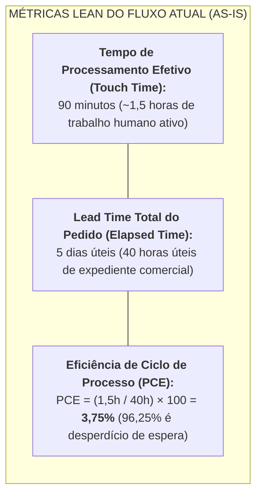
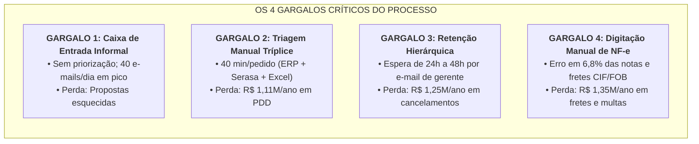
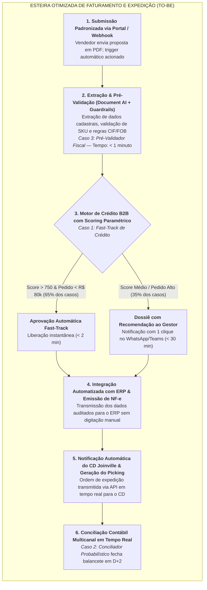

# 🔄 MAPEAMENTO LEAN DO MACROPROCESSO DE PEDIDOS (MATRIZ SIPOC)
**Taranis Black Mobiliário Corporativo & Ergonomia Ativa S.A.**  
**Documento de Entrega — Rota 4 (Finanças e Operações) | AI for Business (ONE G11)**  
**Público-Alvo:** CEO, Diretor Financeiro (CFO), Gerente de Operações e CD Joinville  
**Data de Emissão:** Ano Fiscal 2026 | Versão 1.0  
**Autor:** Consultor de IA  

---

## Executive Summary: O Diagnóstico do Fluxo de Pedidos B2B

O macroprocesso de pedidos corporativos da **Taranis Black** é o principal motor de receita da companhia, respondendo por **70% do faturamento anual (R$ 33,6 milhões)** e movimentando entre **180 e 220 pedidos corporativos faturados por mês**. Embora a meta corporativa para 2026 estabeleça que o ciclo completo — entre a assinatura da proposta e o despacho físico no Centro de Distribuição em Joinville/SC — não deve ultrapassar **24 horas úteis**, a esteira atual opera com um **Lead Time médio de 5 dias úteis (40 horas úteis de expediente)**.

Essa fricção operacional resulta em:
1. **R$ 3.890.000 / ano em perdas e custos diretos evitáveis** (R$ 1,25M em pedidos cancelados por morosidade, R$ 1,11M em perdas de crédito/PDD, R$ 960k em fretes expressos/reentregas, R$ 390k em divergências tributárias e R$ 180k em sobrejornada contábil).
2. **Eficiência de Ciclo de Processo (PCE) crítica de apenas 3,75%**, revelando que mais de **96% do tempo** que um pedido passa dentro da empresa é composto por filas de espera em caixas de entrada de e-mail e conferências manuais redundantes.

Este artefato apresenta a **Matriz Lean SIPOC**, o diagnóstico quantitativo de gargalos (*Bottleneck Analysis*) e o desenho da esteira futura otimizada por agentes de IA (*To-Be*), reduzindo o Lead Time para **menos de 2 horas úteis**.

---

## 1. Matriz SIPOC Estruturada (Macroprocesso As-Is)

A matriz **SIPOC (Suppliers, Inputs, Process, Outputs, Customers)** mapeia as 5 etapas da esteira de faturamento da Taranis Black, identificando fornecedores, dados de entrada, procedimentos manuais, entregáveis e clientes internos/externos.

| S (Fornecedores / *Suppliers*) | I (Entradas / *Inputs*) | P (Macroprocesso / *Process - As-Is*) | O (Saídas / *Outputs*) | C (Clientes / *Customers*) |
|---|---|---|---|---|
| **1. Consultores de Vendas B2B & SDRs** | • Proposta comercial em PDF assinada pelo cliente • Especificações técnicas de SKU (ErgoPro, SmartDesk, Silence) • Condições comerciais negociadas (ex: 30-60-90 dias) | **Passo 1: Recebimento e Triagem Manual de Proposta** Vendedor envia e-mail informal para `financeiro@taranisblack.com.br` com PDF anexado, sem pré-validação de estoque, limite de crédito ou verificação fiscal de CNPJ (pico de >40 e-mails no fechamento). | • E-mail acumulado na caixa de entrada sem ordem de prioridade • Ordem de venda aguardando abertura em fila | • Assistentes Financeiros (Análise de crédito) • Time Comercial |
| **2. Clientes Corporativos B2B & Bureau Serasa Experian** | • Dados cadastrais (Razão Social, CNPJ, IE, Endereço de entrega) • Score de crédito, protestos, ações e dívidas ativas da Serasa • Histórico financeiro interno no ERP legado | **Passo 2: Triagem Manual e Pesquisa de Birô de Crédito** Assistente chaveia entre 3 telas (ERP, portal Serasa web e planilha Excel `Controle_Limites_2026.xlsx`), consumindo 40 minutos por proposta para cópia manual de dados. | • Dossiê manual compilado na planilha local • Histórico de compras anteriores consolidado • Parecer preliminar de risco | • Gerente Financeiro (Aprovador de alçada) • Assistente Financeiro |
| **3. Assistentes Financeiros & Gerência Financeira** | • Planilha de limites atualizada manualmente • Resumo do pedido montado no corpo do e-mail • Solicitação formal de liberação de alçada | **Passo 3: Solicitação e Espera de Decisão Hierárquica** Inexistência de motor de regras automático. Pedidos de qualquer montante (mesmo R$ 8.000 para clientes idôneos) aguardam resposta por e-mail do Gerente Financeiro, que retém o fluxo por 24h a 48h úteis. | • E-mail com "De acordo" da gerência financeira • Autorização formal de faturamento a prazo | • Assistente de Faturamento • Consultor Comercial (Aguardando resposta) |
| **4. Faturamento, Matriz SP & SEFAZ** | • Autorização por e-mail da gerência • Tabela de preços de vendas (`Tabela_Precos_Vendas.xlsx`) • Certificado digital e regras fiscais da SEFAZ | **Passo 4: Faturamento Manual e Emissão de NF-e** Assistente digita manualmente o espelho da NF no ERP legado. Erros rotineiros de digitação de SKU, alíquota de ICMS e divergência com a tabela comercial (gerando 6,8% de erros em boletos e NF-e). | • DANFE e arquivo XML da NF-e transmitido à SEFAZ • Boletos bancários 30-60-90 dias gerados • Espelho fiscal no ERP | • Cliente Comprador B2B • Equipe do CD Joinville/SC • Transportadora Homologada |
| **5. Centro de Distribuição (Joinville/SC) & Transportadoras** | • E-mail manual para `expedicao.cd@taranisblack.com.br` • DANFE emitido • Tabela de fretes homologados (CIF/FOB) e cubagem | **Passo 5: Agendamento Logístico, Separação e Despacho** Equipe do CD recebe autorização por e-mail e gera Picking List. Divergências de frete (CIF vs FOB) travam caminhões na doca, gerando diárias de pátio e reentregas de emergência (2,8% da receita). | • Mercadoria conferida e expedida • Minuta de Embarque / Conhecimento de Transporte (CT-e) • Títulos financeiros enviados para conciliação contábil | • Cliente B2B Destinatário • Transportadora • Controladoria (Fechamento) |

---

## 2. Diagnóstico dos Pontos de Fricção (Bottleneck Analysis)

### 2.1 Análise Detalhada dos 4 Gargalos Críticos

1. **Gargalo 1 — Fila de Entrada Despadronizada (Passo 1):**  
   * *Mecanismo de Falha:* O vendedor anexa o PDF e envia para uma caixa geral de e-mails. Não há triagem de completude dos dados cadastrais (ex.: razão social desatualizada, falta de IE ou endereço incompleto).  
   * *Impacto:* Em períodos de pico de final de mês (>40 propostas/dia), propostas de alto valor ficam represadas na caixa de entrada sem ordem de chegada ou de rentabilidade.
2. **Gargalo 2 — Triagem Manual Lenta e Fragmentada (Passo 2):**  
   * *Mecanismo de Falha:* O assistente precisa consultar o Serasa web, copiar informações de score e protestos para a planilha `Controle_Limites_2026.xlsx` e conferir títulos em aberto no ERP legado.  
   * *Impacto:* Consome **40 minutos de digitação por pedido**. Sob sobrecarga, análises são feitas de forma apressada, elevando a taxa de inadimplência (>90 dias) para **3,4% da receita (R$ 1,11M/ano em PDD)**.
3. **Gargalo 3 — Retenção por Alçada Centralizada (Passo 3 e 4):**  
   * *Mecanismo de Falha:* Falta de um motor de regras paramétrico. Qualquer pedido depende da leitura individual e aprovação por e-mail do Gerente Financeiro, que viaja com frequência entre a fábrica e a matriz.  
   * *Impacto:* O pedido fica retido entre **24h e 48h úteis**. Clientes com urgência de implantação cancelam as compras, gerando **R$ 1.250.000 / ano em perda de receita líquida**.
4. **Gargalo 4 — Digitação Manual de NF-e e Conflito Logístico CIF/FOB (Passo 5):**  
   * *Mecanismo de Falha:* Transposição manual de códigos do PDF para o ERP legado. Trocas frequentes de acabamento de produto (ex.: tecido preto vs. cinza) e omissão de regras de frete.  
   * *Impacto:* **6,8% das NF-e emitidas possuem divergência** (R$ 390k/ano em cancelamentos e custos tributários) e os fretes de emergência/reentregas atingem **2,8% da receita (R$ 960k/ano de estouro)**.

---

## 3. Desenho do Fluxo Futuro com IA (*To-Be*)

A modernização com Inteligência Artificial não requer a substituição traumática do ERP legado, mas a inserção de uma **camada inteligente periférica (*Middleware de IA*)** baseada nos três casos de uso estruturados na Rota 0:

---

## 4. Comparativo Sistemático: Fluxo As-Is vs. Fluxo To-Be

| Etapa do Processo | Situação Atual (*As-Is*) | Situação Futura com IA (*To-Be*) | Tecnologia / Mecanismo de IA | Redução de Tempo / Erro |
|---|---|---|---|---|
| **1. Recepção de Propostas** | E-mail manual para o financeiro; sem validação prévia; filas desordenadas no fim do mês. | Upload estruturado com trigger automático via webhook e triagem semântica imediata. | Ingestão orientada a eventos / API Gateway | De 4 horas em fila para **imediato (< 1 min)** |
| **2. Consulta de Bureau & Crédito** | Consulta manual no portal Serasa, cópia para o Excel e chaveamento de 3 telas (40 min). | Consulta via API Serasa automatizada e cruzamento com histórico do ERP via script. | Integração REST API + Pipeline Python | De 40 minutos para **menos de 30 segundos** |
| **3. Aprovação de Alçada** | Espera passiva de 24h a 48h por resposta de e-mail do Gerente Financeiro. | Fast-Track automático para 65% dos pedidos; dossiê executivo com 1 clique para casos de exceção. | **Caso 1: Motor de Crédito B2B** (Heurística + LLM) | De 48 horas para **< 15 min** (Fast-Track) |
| **4. Faturamento & NF-e** | Digitação manual no ERP legado; 6,8% de divergências em códigos SKU e alíquotas. | Preenchimento automático do espelho da NF no ERP com conferência semântica de regras e fretes. | **Caso 3: Pré-Validador Fiscal & Logístico** | Taxa de erro reduzida de **6,8% para < 0,3%** |
| **5. Transmissão para o CD Joinville** | E-mail manual enviado pela matriz; caminhão retido por divergência de frete CIF/FOB. | Picking List transmitido via webhook com regras de frete e rotas logísticas pré-homologadas. | Orquestração Webhook + Validador de Fretes | De 24h para **tempo real (< 5 min)** |
| **6. Conciliação Contábil** | Conferência manual de extratos e 3 planilhas locais; atraso de 5 dias úteis no DRE. | Conciliação diária contínua por pareamento probabilístico (*fuzzy matching*). | **Caso 2: Assistente de Conciliação Contábil** | Fechamento reduzido de **7 dias para D+2** |
| **LEAD TIME TOTAL DO PEDIDO** | **5 dias úteis (40 horas úteis de expediente)** | **Menos de 2 horas úteis** (pedidos Fast-Track despachados em < 24h) | **Plataforma Integrada de IA Corporativa** | **Redução de 95% no Lead Time total** |

---

## 5. Próximos Passos na Rota 4

Com o mapeamento do macroprocesso estruturado e o fluxo *To-Be* validado:
1. **Elaboração do Diagrama de Ishikawa 6M ([`02_diagrama_ishikawa_6m_causas_raiz.md`](./02_diagrama_ishikawa_6m_causas_raiz.md)):** Dissecação exaustiva das causas-raiz nos 6 eixos (Método, Máquina, Mão de Obra, Material, Medição e Meio Ambiente) que sustentam o atraso de 5 dias no fechamento e os desvios de faturamento.
2. **Análise de Variância DRE Orçado vs. Realizado ([`03_diagnostico_orcado_vs_realizado.md`](./03_diagnostico_orcado_vs_realizado.md)):** Apuração das variações de CMV, margens por produto e impacto direto na recuperação dos R$ 4,08M de EBITDA.
