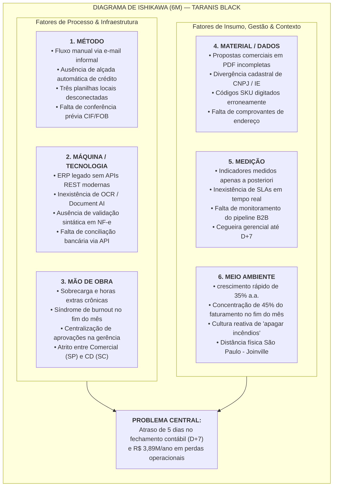
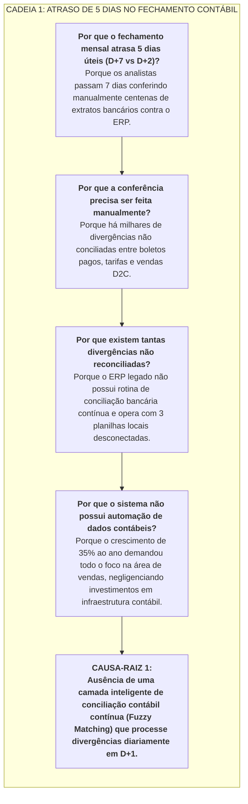
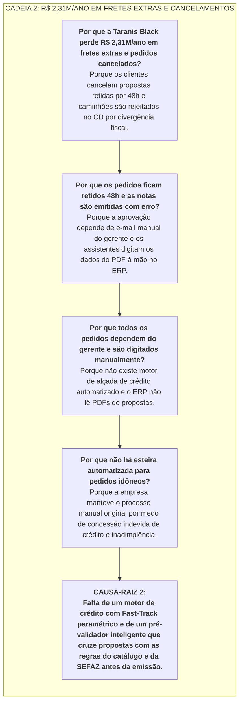
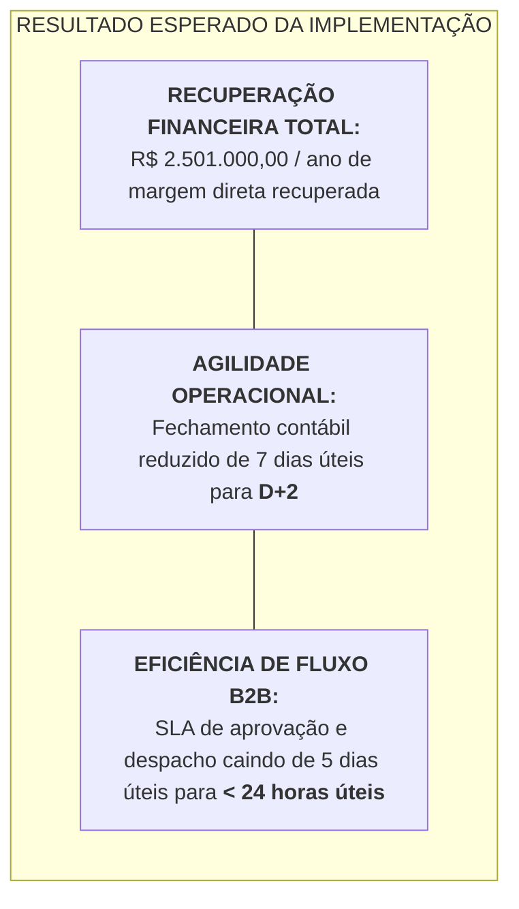

# 🐟 DIAGRAMA DE CAUSA-RAIZ DE ISHIKAWA (6M) & ANÁLISE DOS 5 PORQUÊS
**Taranis Black Mobiliário Corporativo & Ergonomia Ativa S.A.**  
**Documento de Entrega — Rota 4 (Finanças e Operações) | AI for Business (ONE G11)**  
**Público-Alvo:** CEO, Diretor Financeiro (CFO), Gerente de Controladoria e Gerente de Operações  
**Data de Emissão:** Ano Fiscal 2026 | Versão 1.0  
**Autor:** Arley Ribeiro da Silva Xavier | Consultor de IA  

---

## Executive Summary: A Análise Detalhada das Dificuldades Operacionais

A auditoria e o mapeamento Lean SIPOC evidenciaram que as perdas anuais de **R$ 3.890.000,00** e o atraso de **5 dias úteis no fechamento contábil** da Taranis Black não são frutos de falhas pontuais ou incapacidade técnica dos colaboradores, mas sim o resultado de um **descompasso sistêmico de maturidade operacional**: a empresa atingiu R$ 48 milhões de receita através de um crescimento de 35% ao ano, mantendo a mesma esteira manual desenhada para o início de suas atividades.

Este documento aplica a metodologia **Lean Seis Sigma** para dissecar a anatomia desse problema central:
1. **Diagrama de Ishikawa Estruturado nos 6M:** Mapeamento exaustivo das variáveis de Método, Máquina, Mão de Obra, Material, Medição e Meio Ambiente.
2. **Investigação dos 5 Porquês (*Root Cause Analysis*):** Dissecação vertical das causas primárias do atraso contábil e do retrabalho logístico-fiscal.
3. **Plano de Ação Corretivo 5W2H com IA:** Planejamento executivo determinando como as alavancas de Inteligência Artificial eliminam de forma definitiva cada causa-raiz diagnosticada.

---

## 1. O Diagrama de Ishikawa Estruturado nos 6M

---

### 1.1 Detalhamento Técnico das Causas por Eixo (6M)

#### 1. Método (Processos & Procedimentos)
* **Comunicação Informal por E-mail:** Inexistência de um portal ou fluxo estruturado de entrada. Propostas comerciais são disparadas sem ordem de prioridade para `financeiro@taranisblack.com.br`, gerando acúmulo de mais de 40 mensagens diárias nos períodos de fechamento.
* **Inexistência de Matriz de Alçada Paramétrica:** Qualquer proposta a prazo — inclusive pedidos recorrentes de R$ 8.000 de clientes triple-A — exige submissão formal ao Gerente Financeiro, que retém o fluxo por 24h a 48h úteis.
* **Conferência Visual Tríplice:** O assistente financeiro gasta 40 minutos por proposta chaveando visualmente entre a tela do ERP, a consulta no Serasa web e a planilha local `Controle_Limites_2026.xlsx`.
* **Descompasso de Regras de Frete:** Não há conferência antecipada das cláusulas CIF (frete por conta da Taranis Black) e FOB (frete por conta do comprador) no momento da negociação, gerando impasses quando o caminhão chega ao CD.

#### 2. Máquina (Sistemas & Tecnologia)
* **ERP Legado Desconectado:** O ERP central da companhia opera sem capacidade nativa de integração via webhooks ou APIs REST abertas, obrigando as equipes a utilizarem exportações estáticas de relatórios em Excel para todas as análises.
* **Ausência de Ferramentas de Document AI / OCR:** A equipe financeira realiza a leitura humana de cada página dos PDFs de propostas comerciais para digitar os dados no ERP, gerando erros de digitação de códigos SKU e tributos.
* **Inexistência de Pré-Validação de NF-e:** O sistema emite a nota fiscal para a SEFAZ sem validar se a descrição do produto confere com a proposta comercial ou se a alíquota de ICMS interestadual está correta.
* **Ausência de Reconciliação Bancária Automatizada:** A conciliação de extratos bancários, recebimentos de cartões D2C e liquidação de boletos B2B é feita linha a linha por analistas.

#### 3. Mão de Obra (Pessoas & Competências)
* **Sobrecarga Cognitiva e Horas Extras Crônicas:** O time de controladoria acumula centenas de horas extras nos primeiros dias úteis do mês para fechar o balancete, gerando fadiga mental e desmotivação (custo de R$ 180.000/ano).
* **Burnout e Rotatividade Operacional:** O turnover nos primeiros 90 dias atingiu 24%, impulsionado pelo perfil meramente burocrático e mecânico exigido dos assistentes financeiros.
* **Centralização Excessiva da Liderança:** Por receio de inadimplência, a gerência financeira não delega autoridade aos assistentes e acumula dezenas de pedidos pendentes em sua caixa postal enquanto participa de reuniões executivas.
* **Ruído de Comunicação Interdepartamental:** Falta de alinhamento tático entre os consultores de vendas em São Paulo (focados em bater meta de pedidos) e a equipe de expedição do CD em Joinville/SC (focada em prazos de separação e cubagem de fretes).

#### 4. Material (Insumos & Documentação)
* **Propostas Comerciais Despadronizadas em PDF:** Vendedores enviam propostas com rasuras, campos omitidos, divergências na Razão Social e ausência de Inscrição Estadual (IE) atualizada.
* **Divergência entre Tabela Comercial e Cadastro no ERP:** Códigos de produto desatualizados nas tabelas locais de vendedores geram incompatibilidade com o banco de itens cadastrados no ERP, provocando recusa de 6,8% das NF-e.
* **Falta de Comprovante de Endereço Homologado:** Erros em endereços de entrega de clientes B2B (ex.: falta de indicação de doca ou horário de recebimento) causam retenção de carretas na entrega final.

#### 5. Medição (Indicadores & Métricas)
* **Métricas Analisadas Apenas *A Posteriori*:** A Diretoria Executiva só toma conhecimento dos atrasos logísticos, cancelamentos e estouros de frete no encerramento contábil do mês, inviabilizando ações corretivas preventivas.
* **Ausência de Monitoramento de SLAs de Atendimento:** Não há rastreamento do tempo que uma proposta passa em cada etapa da esteira (SDR $\rightarrow$ Crédito $\rightarrow$ Faturamento $\rightarrow$ CD Joinville).
* **Falta de Visibilidade Contínua do Pipeline de Faturamento:** A diretoria financeira não possui um painel em tempo real da carteira de pedidos represados por pendência de crédito.

#### 6. Meio Ambiente (Cultura & Contexto Organizacional)
* **crescimento rápido Desestruturado (35% a.a.):** O volume de pedidos corporativos triplicou nos últimos 3 anos, enquanto os métodos de gestão permaneceram idênticos aos de uma empresa iniciante.
* **Sazonalidade Crítica de Fechamento de Metas:** Mais de 45% do faturamento mensal é submetido nos últimos três dias úteis do mês comercial, gerando estrangulamento da esteira operacional.
* **Cultura de "Apagar Incêndios":** Gestores e analistas priorizam pedidos que geram atrito no WhatsApp, negligenciando a padronização e a causa-raiz dos desvios.

---

## 2. Aplicação da Técnica dos "5 Porquês" nas Causas Críticas

---

## 3. Matriz de Plano de Ação 5W2H Lean com Inteligência Artificial

Para erradicar definitivamente as causas-raiz identificadas nos 6M e nos 5 Porquês, apresentamos o plano de ação estruturado no padrão **5W2H (What, Why, Where, When, Who, How, How Much)**, operacionalizando os 3 casos de uso da Rota 0:

| Dimensão 5W2H | Ação 1: Pré-Validador Fiscal & Logístico (Quick Win) | Ação 2: Conciliador Contábil Multicanal (DRE em D+2) | Ação 3: Motor Inteligente de Crédito B2B (Fast-Track) |
|---|---|---|---|
| **WHAT** *(O que fazer?)* | Implantar middleware de conferência prévia e validação cruzada entre propostas em PDF, catálogo SKU e regras de frete CIF/FOB. | Construir rotina automatizada de ingestão diária de extratos bancários (OFX/CSV) e reconciliação contábil com *fuzzy matching*. | Desenvolver motor de decisão de crédito com extração de dados da proposta via Document AI e consulta à API Serasa Experian. |
| **WHY** *(Por que fazer?)* | Eliminar R$ 960k/ano em fretes de emergência e R$ 390k/ano em cancelamentos fiscais, reduzindo o índice de erro na NF de 6,8% para < 0,3%. | Eliminar o atraso recorrente de 5 dias no fechamento (meta D+2) e economizar R$ 180k/ano em horas extras de controladoria. | Eliminar a retenção de 48h em aprovação, recuperando R$ 1,25M/ano em pedidos cancelados e estancando R$ 1,11M em inadimplência. |
| **WHERE** *(Onde aplicar?)* | Na esteira de faturamento da Matriz SP e no terminal de recepção de ordens do CD Joinville/SC. | No departamento de Controladoria & Contabilidade (integrado aos bancos e ao ERP). | Na caixa de entrada comercial de propostas B2B e no sistema de crédito da Gerência Financeira. |
| **WHEN** *(Quando executar?)* | **Onda 1:** Semanas 1 a 4 (Início imediato em modo piloto assistido). | **Onda 2:** Semanas 5 a 8 (Primeiro fechamento automatizado no Mês 2). | **Onda 3:** Semanas 9 a 12 (Entrada em produção integral no trimestre). |
| **WHO** *(Quem é o responsável?)* | Coordenador de Faturamento & Gerente do CD Joinville. | Coordenador de Controladoria & Gerente Financeiro. | Gerente de Crédito & Cobrança e Consultor de IA. |
| **HOW** *(Como executar?)* | Pipeline em Python com bibliotecas de visão documental e *guardrails* semânticos que comparam o PDF assinado com o cadastro oficial. | Agente analítico em Python executando comparação de saldos, classificação de despesas e geração da minuta de DRE diária. | API Gateway consumindo endpoints da Serasa e aplicando matriz de alçadas: pedidos < R$ 80k e score > 750 aprovados em < 15 min. |
| **HOW MUCH** *(Quanto custará?)* | **Custo:** R$ 50.000 (CAPEX de implementação). **Retorno:** R$ 945.000 / ano recuperados. | **Custo:** R$ 60.000 (CAPEX de desenvolvimento). **Retorno:** R$ 126.000 / ano em economia direta + DRE preditivo. | **Custo:** R$ 140.000 (CAPEX + licenças Serasa). **Retorno:** R$ 1.430.000 / ano em vendas salvas e risco mitigado. |

---

## 4. Síntese dos Impactos para a Liderança Executiva

---
*Artefato homologado e integrado ao dossiê técnico da Rota 4 — Pronto para fundamentar a Análise de Variância DRE Orçado vs. Realizado.*
