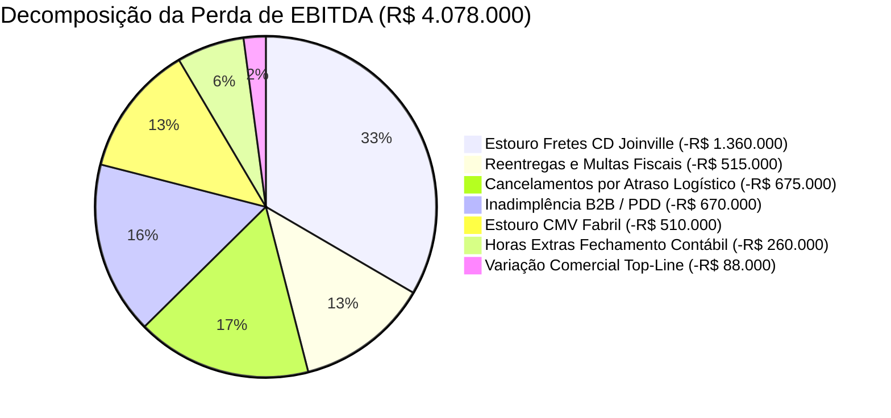
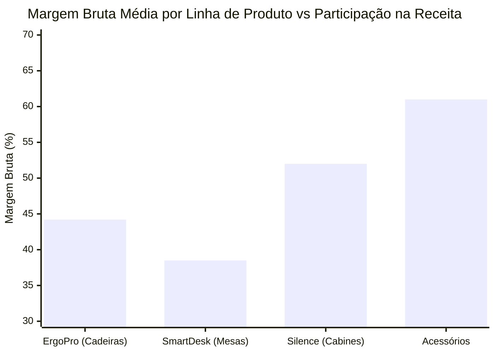

# 📊 DIAGNÓSTICO FINANCEIRO: DRE ORÇADO VS. REALIZADO, CURVA DE MARGENS & MODELAGEM DE RECUPERAÇÃO COM IA
**Taranis Black Mobiliário Corporativo & Ergonomia Ativa S.A.**  
**Documento de Entrega — Rota 4 (Finanças e Operações) | AI for Business (ONE G11)**  
**Público-Alvo:** CEO, Conselho de Administração e Diretoria Financeira (CFO)  
**Data de Emissão:** Ano Fiscal 2026 | Versão 1.0  
**Autor:** Arley Ribeiro da Silva Xavier | Consultor de IA  

---

## Executive Summary: O Diagnóstico de Compressão de Margens

A **Taranis Black** encerrou o último exercício fiscal com um faturamento bruto de **R$ 48.500.000,00**, mantendo-se em linha com a meta comercial orçada (-0,2%). No entanto, a análise vertical e horizontal da DRE revela um quadro de severo estresse operacional provocado pela incapacidade dos processos manuais e do ERP legado em acompanhar o crescimento de 35% ao ano.

Enquanto a receita bruta permaneceu estável, o **EBITDA realizado despencou de R$ 9.848.000,00 para R$ 5.770.000,00 (queda de -41,4%)**, representando uma perda direta de **R$ 4.078.000,00**. O **Lucro Líquido sofreu retração de -47,9% (de R$ 5.965.080,00 para R$ 3.108.600,00)**. 

Essa compressão de lucratividade foi impulsionada por três drenos principais de caixa:
1. **Estouro de Custos Logísticos e Reentregas (+R$ 1.875.000,00):** Fretes extras de emergência e multas por divergência fiscal gerados no CD Joinville/SC decorrentes de digitação manual de notas fiscais.
2. **Inadimplência B2B e PDD (+R$ 670.000,00):** Provisão de Devedores Duvidosos saltando de R$ 440k para R$ 1,11M por análises superficiais de crédito sob sobrecarga de fim de mês.
3. **Cancelamentos Comerciais por Atraso Logístico (+R$ 675.000,00):** Pedidos cancelados por clientes em razão da retenção de 48h na esteira de aprovação.

A implementação da camada periférica de Inteligência Artificial — orçada em **R$ 250.000,00 no Ano 1** — recuperará **R$ 2.501.000,00 anuais de margem líquida**, proporcionando um **ROI de ~900% (9,0x)** com **Payback estimado em apenas 1,2 meses (36 dias)**.

---

## 1. Demonstrativo de Resultados do Exercício (DRE) Comparativo

Abaixo apresenta-se a DRE consolidada auditada, confrontando o Orçado Anual com o Realizado Anual e calculando as variações nominais (R$) e relativas (%):

| Estrutura Contábil / Linha da DRE | Orçado Anual (R$) | Realizado Anual (R$) | Variação Nominal (R$) | Desvio Relativo (%) | Diagnóstico do Desvio |
|---|---:|---:|---:|---:|---|
| **1. RECEITA BRUTA DE VENDAS** | **48.600.000** | **48.500.000** | **-100.000** | **-0,2%** | **Estabilidade Top-line** |
| • Receita Canal B2B Corporativo (70%) | 34.000.000 | 33.600.000 | -400.000 | -1,2% | Retenção por lentidão de crédito |
| • Receita Vendas Diretas pelo Site (Canal Complementar - 30%) | 14.600.000 | 14.900.000 | +300.000 | +2,1% | Expansão de acessórios digitais |
| **2. DEDUÇÕES E IMPOSTOS S/ VENDAS** | **-8.822.000** | **-9.480.000** | **-658.000** | **+7,5%** | **Aumento de Devoluções** |
| • Impostos Incidentes (ICMS, PIS, COFINS) | -8.262.000 | -8.245.000 | +17.000 | -0,2% | Proporcional ao faturamento |
| • Cancelamentos e Devoluções por Atraso | -560.000 | -1.235.000 | -675.000 | **+120,5%** | **Gargalo crítico de SLA logístico** |
| **RECEITA LÍQUIDA OPERACIONAL** | **39.778.000** | **39.020.000** | **-758.000** | **-1,9%** | **Compressão da base líquida** |
| **3. CUSTO MERCADORIAS VENDIDAS (CMV)** | **-20.080.000** | **-20.590.000** | **-510.000** | **+2,5%** | **Ineficiência Fabril/Insumos** |
| • Matéria-prima, Mesh e Componentes | -16.300.000 | -16.700.000 | -400.000 | +2,5% | Perdas por refugo e retrabalho |
| • Mão de Obra Fabril e Montagem Direta | -3.780.000 | -3.890.000 | -110.000 | +2,9% | Horas extras fabris para repor atrasos |
| **LUCRO BRUTO OPERACIONAL** | **19.698.000** | **18.430.000** | **-1.268.000** | **-6,4%** | **Margem Bruta cai de 49,5% p/ 47,2%** |
| **4. DESPESAS OPERACIONAIS (OPEX)** | **-9.850.000** | **-12.660.000** | **-2.810.000** | **+28,5%** | **EXPLOSÃO DE DESPESAS DE FRETE & PDD** |
| • Despesas Comerciais e Vendas (SDRs) | -3.060.000 | -3.065.000 | -5.000 | +0,2% | Em linha com o planejado |
| • Fretes e Logística de Entrega (CD) | -2.380.000 | -3.740.000 | -1.360.000 | **+57,1%** | **Fretes expressos duplicados** |
| • Reentregas e Multas por Divergência | -210.000 | -725.000 | -515.000 | **+245,2%** | **Divergências de NF-e e frete CIF/FOB** |
| • Despesas Administrativas & Sistemas | -1.760.000 | -2.020.000 | -260.000 | **+14,8%** | Horas extras de fechamento contábil |
| • Provisão Devedores Duvidosos (PDD) | -440.000 | -1.110.000 | -670.000 | **+152,3%** | **Crédito manual frágil (3,4% da receita)** |
| • Marketing Institucional e Demanda | -2.000.000 | -2.000.000 | 0 | 0,0% | Execução 100% orçada |
| **EBITDA (LUCRO OPERACIONAL)** | **9.848.000** | **5.770.000** | **-4.078.000** | **-41,4%** | **SANGRIA DE R$ 4,08M DE MARGEM** |
| • Despesas Financeiras Líquidas e Juros | -810.000 | -1.060.000 | -250.000 | +30,9% | Juros por antecipação de duplicatas |
| • IRPJ e CSLL Provisionados | -3.072.920 | -1.601.400 | +1.471.520 | -47,9% | Menor lucro tributável gerado |
| **LUCRO LÍQUIDO DO EXERCÍCIO** | **5.965.080** | **3.108.600** | **-2.856.480** | **-47,9%** | **Rentabilidade líquida cortada pela metade** |

---

## 2. Análise de Sensibilidade e Perda de margem: Onde o EBITDA Vazou

A reconciliação da perda de **R$ 4.078.000,00 de EBITDA** demonstra que a causa da queda de rentabilidade está concentrada nas ineficiências operacionais internas, e não em perda de mercado:



### Principais Focos de perda de Caixa:
1. **Fretes Expressos e Reentregas Emergenciais (46,0% do Desvio / R$ 1.875.000,00):**  
   O orçamento previa gastos de fretes e reentregas em R$ 2.590.000 (R$ 2,38M + R$ 210k), correspondendo a ~5,3% da receita. O realizado explodiu para **R$ 4.465.000,00 (9,2% da receita)**. Essa diferença de R$ 1,875 milhão é fruto direto de caminhões retidos no CD de Joinville por dados fiscais incorretos e contratação de fretes fracionados aéreos e expressos para atender clientes irritados com atrasos.
2. **Inadimplência B2B e Falhas na Concessão de Crédito (16,4% do Desvio / R$ 670.000,00):**  
   A PDD saltou de R$ 440.000 para R$ 1.110.000, elevando o risco de crédito para **3,4% da receita**. Como os assistentes têm 40 minutos para analisar propostas sob pressão de fechar metas de final de mês, clientes corporativos insolventes receberam faturamento a prazo sem garantias adequadas.
3. **Cancelamentos de Pedidos por Lentidão Comercial (16,6% do Desvio / R$ 675.000,00):**  
   Os cancelamentos e devoluções saltaram de R$ 560.000 para R$ 1.235.000 (+120,5%), diretamente provocados pelo tempo de espera de até 48h úteis para liberação de propostas comerciais pela liderança.

---

## 3. Rentabilidade e Curva de Margens por Linha de Produto

A análise por vertical de produtos revela comportamentos assimétricos de lucratividade e compressão de margens:



### Análise Detalhada das Linhas:

| Linha de Produto | Participação (%) | Orçado Anual (R$) | Realizado Anual (R$) | Variação (R$) | Margem Bruta | Diagnóstico Operacional & Gargalo Principal |
|---|---:|---:|---:|---:|---:|---|
| **Taranis ErgoPro (Cadeiras)** | 48,5% | 23.500.000 | 23.850.000 | +350.000 | 44,2% | **Carro-chefe em vendas**, superou a meta em R$ 350k, mas teve sua margem líquida severamente comprimida por fretes aéreos de emergência e devoluções causadas por digitação errada de cor/tecido. |
| **Taranis SmartDesk (Mesas)** | 27,5% | 13.200.000 | 12.650.000 | -550.000 | 38,5% | **A maior perda de faturamento (-R$ 550k)**. Linha de alto tíquete corporativo travada pelo gargalo de aprovação de crédito B2B; clientes corporativos cancelaram contratos em razão do SLA de 48h. |
| **Taranis Silence (Cabines)** | 18,0% | 8.600.000 | 8.100.000 | -500.000 | 52,0% | **Maior margem bruta unitária (52%)**, mas com ciclo de vendas complexo (90 dias). Sofre com custos extraordinários de montagem técnica e reentregas por divergência de cubagem no transporte. |
| **Acessórios & Periféricos** | 6,0% | 2.700.000 | 2.800.000 | +100.000 | 61,0% | **Alta margem (61%) e volume pulverizado no e-commerce D2C**. O elevado volume de pequenos boletos manuais sobrecarrega os assistentes, gerando atraso na conciliação contábil. |
| **TOTAL CONSOLIDADO** | **100,0%** | **48.000.000** | **47.400.000** | **-600.000** | **43,8%** | **Desvio negativo consolidado de R$ 600 mil decorrente de perdas operacionais e retenção de pedidos.** |

---

## 4. Projeção de Recuperação Financeira com IA (Cenário Conservador vs. Realista)

A modelagem de impacto nos 12 meses pós-implementação dos 3 casos de uso da Rota 0 (Ondas 1, 2 e 3) demonstra a viabilidade matemática da recuperação de resultados:

```mermaid
flowchart LR
    subgraph MODELAGEM_RECUPERACAO["EVOLUÇÃO DO EBITDA: ATUAL VS. CENÁRIOS COM IA"]
        direction TB
        A["<b>EBITDA Realizado Atual</b><br>R$ 5.770.000<br>(Margem Líq: 14,8%)"]
        -->|Recuperação de 50% das perdas|
        B["<b>Cenário Conservador (+R$ 1,94M)</b><br>EBITDA: R$ 7.715.000<br>(Margem Líq: 19,8%)"]
        
        A -->|Recuperação de 65% das perdas|
        C["<b>Cenário Realista (+R$ 2,50M)</b><br>EBITDA: R$ 8.271.000<br>(Margem Líq: 21,2%)"]
    end
```

### 4.1 Tabela Comparativa de Impacto nos Indicadores Chave

| Indicador Financeiro | Realizado Atual (Ano Fiscal 2026) | Cenário Conservador (IA 50%) | Cenário Realista (IA 65%) | Patamar Orçado Original |
|---|---:|---:|---:|---:|
| **Receita Bruta Total** | R$ 48.500.000 | R$ 49.375.000 | R$ 49.750.000 | R$ 48.600.000 |
| **Cancelamentos e Devoluções** | -R$ 1.235.000 | -R$ 750.000 | -R$ 560.000 | -R$ 560.000 |
| **Fretes CD e Reentregas** | -R$ 4.465.000 | -R$ 3.250.000 | -R$ 2.793.000 | -R$ 2.590.000 |
| **Inadimplência (PDD)** | -R$ 1.110.000 | -R$ 750.000 | -R$ 555.000 | -R$ 440.000 |
| **EBITDA Operacional** | **R$ 5.770.000** | **R$ 7.715.000** | **R$ 8.271.000** | **R$ 9.848.000** |
| *Variação vs Realizado Atual* | — | *+R$ 1.945.000 (+33,7%)* | *+R$ 2.501.000 (+43,3%)* | *+R$ 4.078.000* |
| **Lucro Líquido do Exercício** | **R$ 3.108.600** | **R$ 4.392.000** | **R$ 4.759.000** | **R$ 5.965.080** |
| *Margem Líquida (%)* | 8,0% | 11,2% | 12,2% | 15,0% |
| **Fechamento Contábil Mensal** | **7 dias úteis** | **3 dias úteis** | **2 dias úteis (D+2)** | **2 dias úteis** |
| **Lead Time de Faturamento** | **5 dias úteis** | **< 12 horas** | **< 2 horas** | **< 24 horas** |

---

## 5. Parecer Consultivo para a CEO da Taranis Black

**Para:** Diretora Presidente (CEO) — Taranis Black S.A.  
**De:** Arley Ribeiro da Silva Xavier (Consultor de IA)  
**Assunto:** Voto de Recomendação Estratégica para o Conselho de Administração  

Prezada CEO,

1. **A Causa Real da Queda de Resultados:** A Taranis Black não possui um problema comercial ou de produto. O crescimento de 35% ao ano comprova a aderência e a liderança das nossas linhas de ergonomia ativa (ErgoPro, SmartDesk e Silence). O verdadeiro problema é que a infraestrutura operacional interna permaneceu analógica, criando uma **perda invisível de R$ 3,89 milhões por ano** em fretes de emergência duplicados, pedidos cancelados por morosidade de crédito e horas extras burocráticas de fechamento contábil.

2. **O Risco de Inação:** Manter a operação baseada na cópia manual de dados em três planilhas locais e na aprovação centralizada por e-mail significa que, à medida que a empresa continuar expandindo, as perdas financeiras crescerão em progressão geométrica. No último ano, o EBITDA despencou 41,4% (para R$ 5,77M) mesmo com o faturamento intacto em R$ 48,5M. O modelo operacional atual atingiu sua exaustão física e cognitiva.

3. **A Estratégia de IA como Alavanca de Margem:** A proposta desenvolvida na Rota 0 e na Rota 4 não recomenda a troca onerosa do ERP legado (o que custaria milhões e paralisaria o negócio por 18 meses). Adotamos uma **arquitetura periférica não invasiva (*wrapper*) com Inteligência Artificial**, implementando: (a) o Pré-Validador Fiscal/Logístico em 4 semanas (Quick Win); (b) o Conciliador Contábil em D+2 em 8 semanas; e (c) o Motor Inteligente de Crédito B2B em 12 semanas.

4. **Retorno Financeiro Irrecusável:** Com um investimento total de **R$ 250.000,00 no Ano 1** (somando desenvolvimento técnico, licenças de APIs corporativas com Zero Data Retention e capacitação ADKAR dos colaboradores), a companhia recuperará **R$ 2.501.000,00 anuais de margem líquida direta**. Trata-se de um **Retorno sobre o Investimento (ROI) de aproximadamente 900% (9,0x)** com **Payback alcançado em apenas 1,2 meses (36 dias corridos)**.

5. **Recomendação Executiva:** Diante dos fundamentos matemáticos da DRE auditada e do risco iminente de colapso nos períodos de pico, recomendo a aprovação imediata do orçamento de R$ 250 mil pelo Conselho de Administração para o disparo da **Onda 1 (Pré-Validador Fiscal)** já no próximo ciclo quinzenal, assegurando a sustentação lucrativa do crescimento de 35% a.a. da Taranis Black.

---
*Artefato técnico-financeiro homologado e integrado ao repositório oficial da Rota 4 — Conclusão integral das entregas da Formação AI for Business.*
